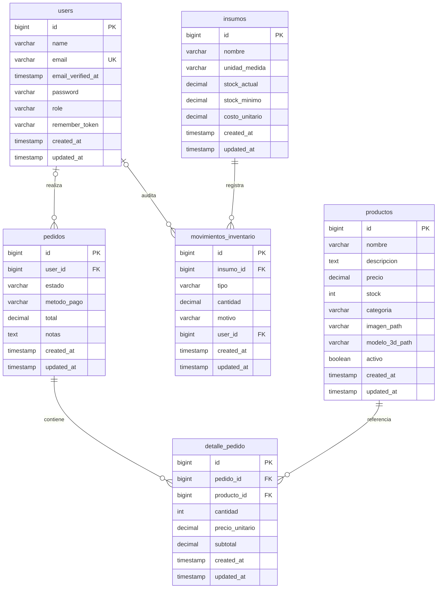

# 01 — Base de datos

Documento de referencia del esquema relacional del proyecto. Todas las tablas viven en la base MariaDB `cafeteria` y se crean mediante las migraciones de `database/migrations`. El esquema está modelado con Eloquent; los nombres de tabla que no siguen la convención plural de Laravel se declaran explícitamente en el modelo.

- Motor: MariaDB 11.8, charset `utf8mb4`.
- Claves primarias: `bigint unsigned` autoincrementales (`$table->id()`).
- Marcas de tiempo: `created_at` y `updated_at` nullable (`$table->timestamps()`).
- Importes monetarios: `decimal(10,2)`.
- Cantidades de inventario: `decimal(10,3)`.

## Diagrama entidad-relación



Cardinalidades del diagrama:

- Un `user` realiza cero o muchos `pedidos`; cada pedido pertenece a cero o un usuario. Los pedidos de invitado tienen `user_id` `NULL`.
- Un `pedido` agrupa cero o muchas líneas de `detalle_pedido`; cada línea pertenece a un solo pedido.
- Un `producto` puede aparecer en cero o muchas líneas de detalle; cada línea referencia un solo producto.
- Un `insumo` acumula cero o muchos `movimientos_inventario`; cada movimiento afecta a un solo insumo.
- Un `user` puede registrar cero o muchos movimientos; `movimientos_inventario.user_id` es opcional, de modo que el histórico sobrevive si se elimina el usuario.

## Diccionario de tablas

### `users`

Tabla base de Laravel para autenticación, extendida con la columna `role`.

| Columna | Tipo | Restricciones | Notas |
| --- | --- | --- | --- |
| `id` | `bigint unsigned` | PK, autoincremental | |
| `name` | `varchar(255)` | NOT NULL | Nombre visible del usuario. |
| `email` | `varchar(255)` | NOT NULL, UNIQUE | Credencial de acceso. |
| `email_verified_at` | `timestamp` | NULL | Presente, aunque el modelo `User` no implementa `MustVerifyEmail`. |
| `password` | `varchar(255)` | NOT NULL | Hash (cast `hashed` en el modelo). |
| `role` | `varchar(255)` | NOT NULL, default `'cliente'`, INDEX | Añadida por `2026_11_08_160119_add_role_to_users_table` con `after('password')`. Cast al enum `App\Enums\Rol`. |
| `remember_token` | `varchar(100)` | NULL | Token de "recordarme" de Laravel. |
| `created_at` | `timestamp` | NULL | |
| `updated_at` | `timestamp` | NULL | |

Índice: `users_role_index` sobre `role`.

El valor de `role` se almacena como cadena y se castea a `Rol` (`Cliente = 'cliente'`, `Admin = 'admin'`). El detalle funcional está en [02-roles-y-autenticacion.md](02-roles-y-autenticacion.md#definición-de-roles).

### `productos`

Catálogo de productos de la cafetería. Los campos `imagen_path` y `modelo_3d_path` preparan el catálogo con visor 3D (RF-02, RNF-01). El uso funcional de `modelo_3d_path` está documentado en [03-catalogo-y-visor-3d.md](03-catalogo-y-visor-3d.md).

| Columna | Tipo | Restricciones | Notas |
| --- | --- | --- | --- |
| `id` | `bigint unsigned` | PK, autoincremental | |
| `nombre` | `varchar(255)` | NOT NULL | |
| `descripcion` | `text` | NULL | |
| `precio` | `decimal(10,2)` | NOT NULL | Precio de venta; cast `decimal:2`. |
| `stock` | `int unsigned` | NOT NULL, default `0` | No admite negativos por el tipo `unsigned`. |
| `categoria` | `varchar(255)` | NULL | Categoría libre (la factory usa `bebidas`, `postres`, `comida`). |
| `imagen_path` | `varchar(255)` | NULL | Ruta relativa a `storage/app/public` (p. ej. `productos/latte.jpg`), servida con `asset('storage/...')`. |
| `modelo_3d_path` | `varchar(255)` | NULL | Ruta relativa a `storage/app/public` (p. ej. `productos/espresso.glb`). Habilita el visor de RF-02. |
| `activo` | `boolean` | NOT NULL, default `true` | Cast `boolean`; permite ocultar productos sin borrarlos. |
| `created_at` | `timestamp` | NULL | |
| `updated_at` | `timestamp` | NULL | |

Índice compuesto: `productos_activo_categoria_index` sobre `(activo, categoria)`, pensado para listar el catálogo visible filtrado por categoría.

### `pedidos`

Cabecera de cada pedido realizado por un cliente autenticado o por un invitado (RF-03, RF-04).

| Columna | Tipo | Restricciones | Notas |
| --- | --- | --- | --- |
| `id` | `bigint unsigned` | PK, autoincremental | |
| `user_id` | `bigint unsigned` | NULL, FK → `users.id`, `RESTRICT` | Autor del pedido; `NULL` en pedidos de invitado. |
| `estado` | `varchar(255)` | NOT NULL, default `'pendiente'`, INDEX | Cast al enum `App\Enums\EstadoPedido`. |
| `metodo_pago` | `varchar(255)` | NOT NULL, default `'efectivo'` | Cast al enum `App\Enums\MetodoPago`; añadida por `2026_11_08_163735_add_metodo_pago_and_allow_guest_user_to_pedidos_table`. |
| `total` | `decimal(10,2)` | NOT NULL, default `0` | Importe total; cast `decimal:2`. |
| `notas` | `text` | NULL | Observaciones del cliente (máximo 500 caracteres validado en la aplicación). |
| `created_at` | `timestamp` | NULL | |
| `updated_at` | `timestamp` | NULL | |

Índice: `pedidos_estado_index` sobre `estado`, para filtros operativos por estado.

La migración original declaraba `user_id` como `NOT NULL` con `restrictOnDelete()`. La migración `2026_11_08_163735_add_metodo_pago_and_allow_guest_user_to_pedidos_table` lo hace nullable para permitir el checkout sin cuenta, pero conserva la FK `RESTRICT`: no se puede eliminar un usuario que tenga pedidos. La misma migración agrega `metodo_pago` con default `'efectivo'`.

El `down()` de esa migración es no destructivo: si existen pedidos con `user_id` `NULL`, no revierte los cambios para no perder información y deja un aviso en el log. Por eso no debe asumirse que `migrate:rollback` restaura el esquema original en una base con pedidos de invitado.

### `detalle_pedido`

Líneas de producto de cada pedido. El modelo `DetallePedido` fija `protected $table = 'detalle_pedido'` porque Laravel pluralizaría a `detalle_pedidos`.

| Columna | Tipo | Restricciones | Notas |
| --- | --- | --- | --- |
| `id` | `bigint unsigned` | PK, autoincremental | |
| `pedido_id` | `bigint unsigned` | NOT NULL, FK → `pedidos.id`, `CASCADE` | Al borrar el pedido se eliminan sus líneas. |
| `producto_id` | `bigint unsigned` | NOT NULL, FK → `productos.id`, `RESTRICT` | No se puede borrar un producto referenciado. |
| `cantidad` | `int unsigned` | NOT NULL | Cast `integer`. |
| `precio_unitario` | `decimal(10,2)` | NOT NULL | Copia del precio al momento de la compra. |
| `subtotal` | `decimal(10,2)` | NOT NULL | `cantidad × precio_unitario`; cast `decimal:2`. |
| `created_at` | `timestamp` | NULL | |
| `updated_at` | `timestamp` | NULL | |

La tabla no tiene índice adicional aparte de las claves foráneas; las consultas habituales filtran por `pedido_id`.

### `insumos`

Materias primas controladas por inventario (RF-07).

| Columna | Tipo | Restricciones | Notas |
| --- | --- | --- | --- |
| `id` | `bigint unsigned` | PK, autoincremental | |
| `nombre` | `varchar(255)` | NOT NULL | |
| `unidad_medida` | `varchar(255)` | NOT NULL | Texto libre: `gramos`, `mililitros`, `unidades`, etc. |
| `stock_actual` | `decimal(10,3)` | NOT NULL, default `0` | Cast `decimal:3`. |
| `stock_minimo` | `decimal(10,3)` | NOT NULL, default `0` | Umbral de reposición; cast `decimal:3`. |
| `costo_unitario` | `decimal(10,2)` | NULL | Cast `decimal:2`. |
| `created_at` | `timestamp` | NULL | |
| `updated_at` | `timestamp` | NULL | |

### `movimientos_inventario`

Registro auditable de entradas, salidas y ajustes de stock. El modelo `MovimientoInventario` fija `protected $table = 'movimientos_inventario'` porque la convención generaría `movimiento_inventarios`.

| Columna | Tipo | Restricciones | Notas |
| --- | --- | --- | --- |
| `id` | `bigint unsigned` | PK, autoincremental | |
| `insumo_id` | `bigint unsigned` | NOT NULL, FK → `insumos.id`, `RESTRICT` | Insumo afectado. |
| `tipo` | `varchar(255)` | NOT NULL | Cast al enum `App\Enums\TipoMovimiento`. |
| `cantidad` | `decimal(10,3)` | NOT NULL | Magnitud del movimiento; cast `decimal:3`. |
| `motivo` | `varchar(255)` | NULL | Justificación opcional. |
| `user_id` | `bigint unsigned` | NULL, FK → `users.id`, `SET NULL` | Responsable del registro; se conserva el movimiento si el usuario se elimina. |
| `created_at` | `timestamp` | NULL | |
| `updated_at` | `timestamp` | NULL | |

Índice compuesto: `movimientos_inventario_insumo_id_created_at_index` sobre `(insumo_id, created_at)`, útil para reconstruir el historial de un insumo en orden cronológico.

## Enumeraciones de dominio

Los cuatro enums son `string` y se guardan como texto en la base de datos. No existen restricciones `CHECK` en MariaDB: la validación del dominio ocurre en PHP mediante el cast de Eloquent y, en el checkout, mediante reglas `in:`.

| Enum | Valores | Tabla / columna |
| --- | --- | --- |
| `App\Enums\Rol` | `cliente`, `admin` | `users.role` |
| `App\Enums\EstadoPedido` | `pendiente`, `en_preparacion`, `listo`, `entregado`, `cancelado` | `pedidos.estado` |
| `App\Enums\MetodoPago` | `efectivo`, `tarjeta`, `transferencia` | `pedidos.metodo_pago` |
| `App\Enums\TipoMovimiento` | `entrada`, `salida`, `ajuste` | `movimientos_inventario.tipo` |

## Relaciones Eloquent

| Modelo | Método | Tipo | Modelo destino | FK usada |
| --- | --- | --- | --- | --- |
| `User` | `pedidos()` | `hasMany` | `Pedido` | `pedidos.user_id` |
| `User` | `movimientosInventario()` | `hasMany` | `MovimientoInventario` | `movimientos_inventario.user_id` |
| `Producto` | `detallesPedido()` | `hasMany` | `DetallePedido` | `detalle_pedido.producto_id` |
| `Pedido` | `user()` | `belongsTo` | `User` | `pedidos.user_id` |
| `Pedido` | `detallesPedido()` | `hasMany` | `DetallePedido` | `detalle_pedido.pedido_id` |
| `DetallePedido` | `pedido()` | `belongsTo` | `Pedido` | `detalle_pedido.pedido_id` |
| `DetallePedido` | `producto()` | `belongsTo` | `Producto` | `detalle_pedido.producto_id` |
| `Insumo` | `movimientosInventario()` | `hasMany` | `MovimientoInventario` | `movimientos_inventario.insumo_id` |
| `MovimientoInventario` | `insumo()` | `belongsTo` | `Insumo` | `movimientos_inventario.insumo_id` |
| `MovimientoInventario` | `user()` | `belongsTo` | `User` | `movimientos_inventario.user_id` |

Los modelos usan el atributo `#[Fillable([...])]` de Laravel 13 en lugar de la propiedad `$fillable`. Todos cuentan con factory en `database/factories`, lo que permite generar datos de prueba coherentes (por ejemplo, `DetallePedidoFactory` calcula `subtotal` a partir de `cantidad` y `precio_unitario`).

`Pedido::user()` es una relación `belongsTo` opcional: devuelve `null` en pedidos de invitado. A la inversa, `User::pedidos()` solo incluye pedidos con `user_id`; los pedidos anónimos no aparecen en el historial de ningún usuario.

## Decisiones de diseño

### Importes en `decimal`, nunca en `float`

`precio`, `total`, `precio_unitario`, `subtotal` y `costo_unitario` usan `decimal(10,2)`. Evita errores de redondeo binario en operaciones monetarias y permite sumar totales con precisión de centavos. El cast `decimal:2` devuelve cadenas con dos decimales, aptas para presentación.

### Cantidades de inventario con tres decimales

`stock_actual`, `stock_minimo` y `movimientos_inventario.cantidad` usan `decimal(10,3)` porque los insumos se miden en gramos o mililitros y necesitan fracciones. El stock de productos terminados (`productos.stock`) es entero sin signo, ya que se cuenta en unidades.

### Borrado en cascada solo donde no hay pérdida de información

- `detalle_pedido.pedido_id` es `CASCADE`: las líneas no tienen sentido sin su pedido y se eliminan con él.
- `pedidos.user_id`, `detalle_pedido.producto_id` y `movimientos_inventario.insumo_id` son `RESTRICT`: impiden borrar entidades con historial asociado y protegen la integridad de pedidos e inventario.
- `movimientos_inventario.user_id` es `SET NULL`: el movimiento es un registro de auditoría y debe sobrevivir aunque se elimine la cuenta del responsable.

### Checkout de invitado con `user_id` nullable

El flujo de compra no exige cuenta: `pedidos.user_id` admite `NULL` para los pedidos de invitado. La FK contra `users.id` se conserva con `RESTRICT`, de modo que la integridad histórica no cambia para los pedidos autenticados y no se puede borrar una cuenta con pedidos. El acceso a la confirmación no se apoya en `user_id`, sino en una URL firmada (`signed`); por eso la vista es genérica y no muestra datos personales. Los detalles funcionales están en [04-carrito-y-pedidos.md](04-carrito-y-pedidos.md#invitado-frente-a-autenticado).

La contrapartida es que los pedidos anónimos no pueden asociarse a un cliente ni listarse desde `User::pedidos()`. Si en el futuro se exige historial de invitados, habría que añadir un identificador de sesión o un token de consulta, no reutilizar `user_id` con un valor ficticio.

### `metodo_pago` como enum de texto

`pedidos.metodo_pago` es `varchar(255)` con default `'efectivo'`, casteado a `App\Enums\MetodoPago`. Al igual que `estado` y `role`, no hay `CHECK` en la base: la aplicación valida el valor con `in:efectivo,tarjeta,transferencia` y el cast falla si se hidrata un valor desconocido. El default de la columna solo cubre inserciones directas por SQL; el checkout siempre escribe un valor validado.

### Instantáneas de precio en las líneas de pedido

`detalle_pedido` guarda `precio_unitario` y `subtotal` en lugar de calcularlos siempre contra `productos.precio`. Así, un cambio de precio posterior no altera el importe histórico del pedido. `pedidos.total` almacena el total consolidado.

### `modelo_3d_path` como ruta, no como binario

Tanto `imagen_path` como `modelo_3d_path` son `varchar(255)` nullable que almacenan rutas **relativas a `storage/app/public`**, no binarios. El archivo vive en el disco `public` (`storage/app/public/productos/*.glb`) y se expone mediante el symlink `public/storage` creado con `php artisan storage:link`; Blade construye la URL con `asset('storage/'.$producto->modelo_3d_path)`. Por eso la ruta guardada no debe incluir el prefijo `storage/` ni una barra inicial.

Guardar el archivo fuera de la base de datos mantiene las consultas ligeras y permite servirlo como estático con caché; es la base del visor interactivo de RF-02. Se recomienda GLB binario con texturas incrustadas y sin compresión Draco (el visor no registra `DRACOLoader`), en línea con el objetivo de carga de RNF-02. Las factories generan ambos campos como `null`, y `ProductoSeeder` también: el repositorio no incluye modelos de ejemplo. La asignación de rutas es manual hasta que el Módulo 4 incorpore la subida desde el panel; la guía operativa está en [03-catalogo-y-visor-3d.md](03-catalogo-y-visor-3d.md#cómo-cargar-un-modelo-real).

### Índices orientados a las consultas previstas

| Índice | Tabla | Uso esperado |
| --- | --- | --- |
| `(activo, categoria)` | `productos` | Catálogo visible agrupado/filtrado por categoría. |
| `estado` | `pedidos` | Bandeja de pedidos por estado. |
| `role` | `users` | Filtrado de usuarios administradores. |
| `(insumo_id, created_at)` | `movimientos_inventario` | Historial cronológico por insumo. |

### Nombres de tabla explícitos

`DetallePedido` y `MovimientoInventario` declaran `$table` porque la pluralización automática de Eloquent no coincide con los nombres migrados (`detalle_pedido` y `movimientos_inventario`). Cualquier consulta con Query Builder debe usar esos nombres exactos.

### Valores por defecto en dos capas

`users.role` y `pedidos.estado` tienen default tanto en la migración como en el modelo/enum. Esto mantiene la coherencia cuando se crean registros por SQL directo o por Eloquent. En el caso de `User`, además, `$attributes = ['role' => 'cliente']` garantiza el rol incluso antes de guardar.

## Tablas de infraestructura de Laravel

Además de las tablas de negocio, las migraciones base crean:

| Tabla | Propósito |
| --- | --- |
| `password_reset_tokens` | Tokens de recuperación de contraseña de Breeze. |
| `sessions` | Sesiones (el proyecto usa `SESSION_DRIVER=database`). |
| `cache`, `cache_locks` | Caché y bloqueos (`CACHE_STORE=database`). |
| `jobs`, `job_batches`, `failed_jobs` | Cola de trabajos (`QUEUE_CONNECTION=database`). |

## Operaciones útiles

```bash
# Recrear el esquema y cargar las cuentas semilla
php artisan migrate:fresh --seed

# Inspeccionar la definición real de una tabla en MariaDB
mysql -u cafeteria -p cafeteria -e "SHOW CREATE TABLE productos\G"
```

No se usan *soft deletes* ni restricciones `CHECK`; la integridad de dominio se apoya en enums PHP, tipos de columna y claves foráneas. Para el comportamiento de autenticación y autorización sobre `users.role`, consulta [02-roles-y-autenticacion.md](02-roles-y-autenticacion.md). Para el uso real de `productos.modelo_3d_path`, el visor Three.js y la carga de archivos GLB, consulta [03-catalogo-y-visor-3d.md](03-catalogo-y-visor-3d.md). Para el carrito, el checkout transaccional y la confirmación de pedidos, consulta [04-carrito-y-pedidos.md](04-carrito-y-pedidos.md).
