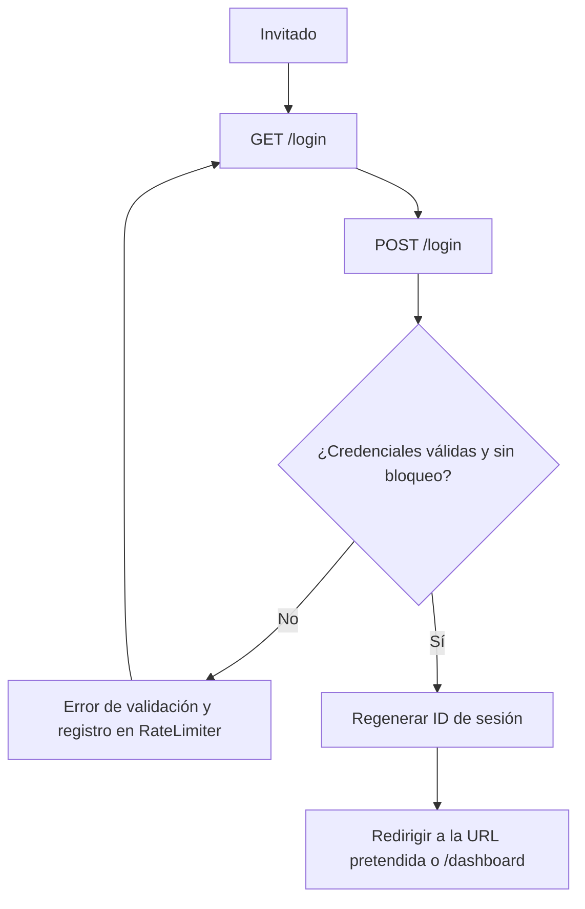
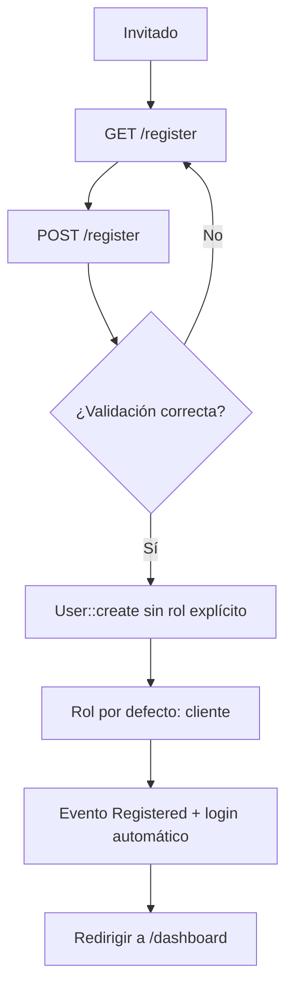
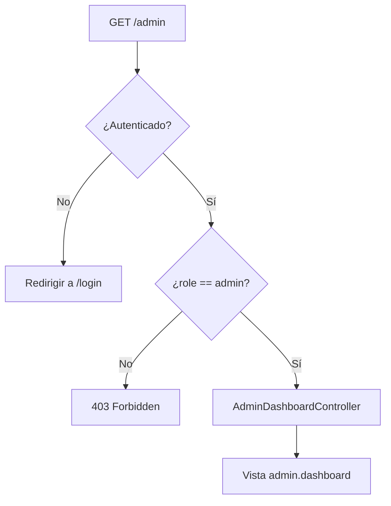

# 02 — Roles y autenticación

Este documento describe el módulo de autenticación y control de acceso, que cubre **RF-01** (registro e inicio de sesión de clientes) y **RNF-03** (autenticación con roles cliente/admin para restringir el panel administrativo). La implementación se apoya en Laravel Breeze 2.4.2 con stack Blade y sesiones de Laravel.

## Componentes del módulo

| Componente | Archivo | Responsabilidad |
| --- | --- | --- |
| Rutas de autenticación | `routes/auth.php` | Registro, login, logout, recuperación y confirmación de contraseña. |
| Rutas principales | `routes/web.php` | Catálogo público, dashboard, perfil y grupo `/admin` protegido. |
| Registro | `app/Http/Controllers/Auth/RegisteredUserController.php` | Crea usuarios con rol por defecto `cliente`. |
| Login | `app/Http/Controllers/Auth/AuthenticatedSessionController.php` + `app/Http/Requests/Auth/LoginRequest.php` | Autenticación con rate limiting y regeneración de sesión. |
| Enum de roles | `app/Enums/Rol.php` | Valores `cliente` y `admin`. |
| Modelo | `app/Models/User.php` | Cast de `role`, helpers `isAdmin()` / `isCliente()` y relaciones. |
| Middleware | `app/Http/Middleware/EnsureUserHasRole.php` | Restringe rutas por rol. |
| Registro del alias | `bootstrap/app.php` | Alias `role` → `EnsureUserHasRole`. |
| Panel administrativo | `app/Http/Controllers/AdminDashboardController.php` + `resources/views/admin/dashboard.blade.php` | Vista inicial del panel. |
| Seeder | `database/seeders/AdminUserSeeder.php` | Cuentas de administrador y cliente de ejemplo. |

## Definición de roles

El rol se modela con un enum `string` respaldado por la columna `users.role` (`varchar(255)`, default `'cliente'`, indexada).

```php
enum Rol: string
{
    case Cliente = 'cliente';
    case Admin = 'admin';
}
```

| Caso | Valor persistido | Descripción |
| --- | --- | --- |
| `Rol::Cliente` | `cliente` | Usuario final: consulta catálogo y realiza pedidos. |
| `Rol::Admin` | `admin` | Acceso al panel de administración. |

El modelo aplica el cast y concentra la comprobación de roles:

```php
protected function casts(): array
{
    return [
        'role' => Rol::class,
        // ...
    ];
}

public function isAdmin(): bool
{
    return $this->role === Rol::Admin;
}
```

Puntos clave:

- `role` está incluido en `#[Fillable(['name', 'email', 'password', 'role'])]`, pero el registro público **no** lo asigna: `RegisteredUserController` solo envía `name`, `email` y `password`. El valor `cliente` proviene del default de la migración y de `$attributes = ['role' => 'cliente']` en el modelo.
- El acceso a `$user->role` devuelve una instancia de `Rol`, no una cadena.
- Los helpers `isAdmin()` e `isCliente()` se usan en las vistas para decidir qué enlaces mostrar.
- El rol es único por usuario: no existe una tabla pivote de roles ni permisos granulares.

## Flujo de autenticación

### Inicio de sesión



- `LoginRequest` valida `email` y `password` y limita a **5 intentos** por combinación de email + IP; al superarlos se dispara el evento `Lockout`.
- `Auth::attempt()` verifica las credenciales; la contraseña se almacena con cast `hashed`.
- Tras autenticar, la sesión se regenera para prevenir fijación de sesión y se redirige con `intended()`.

### Registro



La validación exige `name`, `email` único y `password` confirmado con las reglas por defecto de Laravel.

### Cierre de sesión

`POST /logout` ejecuta `Auth::guard('web')->logout()`, invalida la sesión, regenera el token CSRF y redirige a `/`.

### Acceso al panel administrativo



## Middleware de rol

`EnsureUserHasRole` recibe uno o varios roles permitidos como parámetros del middleware:

```php
public function handle(Request $request, Closure $next, string ...$roles): Response
{
    $role = $request->user()?->role;

    if ($role === null || ! in_array($role->value, $roles, true)) {
        abort(403);
    }

    return $next($request);
}
```

El alias se registra en `bootstrap/app.php`:

```php
->withMiddleware(function (Middleware $middleware): void {
    $middleware->alias([
        'role' => EnsureUserHasRole::class,
    ]);
})
```

Comportamiento:

- Invitado: `$request->user()` es `null`, pero el middleware `auth` se ejecuta antes y redirige a `/login`; `role` nunca llega a evaluarse.
- Usuario autenticado con rol distinto: `abort(403)`.
- Comparación estricta contra `$role->value`, por lo que `role:admin` se escribe con el valor del enum, no con el nombre del caso (`Admin`).
- Al ser variádico, admite listas: `role:admin,empleado`.

## Mapa de rutas y protección

### Rutas públicas

| Método | URI | Nombre | Middleware | Acción |
| --- | --- | --- | --- | --- |
| GET | `/` | `productos.index` | web | Catálogo público (`ProductoController@index`); sustituye a la vista `welcome`. |
| GET | `/productos/{producto}` | `productos.show` | web | Ficha y visor 3D (`ProductoController@show`); 404 si el producto está inactivo. |
| GET | `/carrito` | `carrito.index` | web | Carrito de compra (`CarritoController@index`). |
| POST | `/carrito/agregar` | `carrito.add` | web | Agregar unidades con validación de stock (`CarritoController@add`). |
| POST | `/carrito/quitar` | `carrito.remove` | web | Restar unidades o eliminar la línea (`CarritoController@remove`). |
| POST | `/carrito/vaciar` | `carrito.clear` | web | Vaciar el carrito (`CarritoController@clear`). |
| POST | `/pedido/confirmar` | `pedidos.store` | web | Checkout transaccional (`PedidoController@store`). |
| GET | `/pedido/{pedido}/confirmado` | `pedidos.confirmado` | web, `signed` | Confirmación con URL firmada (`PedidoController@confirmado`). |
| GET | `/up` | — | — | Health check de Laravel. |

Las rutas del catálogo, el carrito y los pedidos son públicas y no interfieren con la autenticación: un invitado puede navegar el catálogo y confirmar un pedido sin iniciar sesión. El carrito vive en la sesión; no se exige una cuenta. La confirmación no usa el middleware `auth`, sino `signed`: la URL firmada es la que habilita consultar número, total y método de pago. Los detalles del catálogo están en [03-catalogo-y-visor-3d.md](03-catalogo-y-visor-3d.md#rutas-y-controlador); los del flujo de compra, en [04-carrito-y-pedidos.md](04-carrito-y-pedidos.md#rutas).

### Rutas para invitados (`guest`)

| Método | URI | Nombre | Acción |
| --- | --- | --- | --- |
| GET | `/register` | `register` | Formulario de registro. |
| POST | `/register` | — | Crear usuario y autenticarlo. |
| GET | `/login` | `login` | Formulario de login. |
| POST | `/login` | — | Autenticar credenciales. |
| GET | `/forgot-password` | `password.request` | Solicitar enlace de recuperación. |
| POST | `/forgot-password` | `password.email` | Enviar enlace por correo. |
| GET | `/reset-password/{token}` | `password.reset` | Formulario de nueva contraseña. |
| POST | `/reset-password` | `password.store` | Guardar la nueva contraseña. |

### Rutas autenticadas (`auth`)

| Método | URI | Nombre | Middleware adicional | Acción |
| --- | --- | --- | --- | --- |
| GET | `/dashboard` | `dashboard` | — | Vista `dashboard`. |
| GET | `/profile` | `profile.edit` | — | Editar perfil. |
| PATCH | `/profile` | `profile.update` | — | Actualizar datos. |
| DELETE | `/profile` | `profile.destroy` | — | Eliminar cuenta. |
| GET | `/verify-email` | `verification.notice` | — | Aviso de verificación. |
| GET | `/verify-email/{id}/{hash}` | `verification.verify` | `signed`, `throttle:6,1` | Verificar correo. |
| POST | `/email/verification-notification` | `verification.send` | `throttle:6,1` | Reenviar verificación. |
| GET | `/confirm-password` | `password.confirm` | — | Confirmar contraseña. |
| POST | `/confirm-password` | — | — | Validar contraseña. |
| PUT | `/password` | `password.update` | — | Cambiar contraseña. |
| POST | `/logout` | `logout` | — | Cerrar sesión. |

> Las rutas de verificación de correo existen porque Breeze las publica, pero `App\Models\User` **no** implementa `MustVerifyEmail` (la importación está comentada). Por tanto, la verificación no se exige para acceder al dashboard.

### Rutas de administración

| Método | URI | Nombre | Middleware | Acción |
| --- | --- | --- | --- | --- |
| GET | `/admin` | `admin.dashboard` | `auth`, `role:admin` | `AdminDashboardController` (invokable) → vista `admin.dashboard`. |

Definición en `routes/web.php`:

```php
Route::middleware(['auth', 'role:admin'])
    ->prefix('admin')
    ->name('admin.')
    ->group(function () {
        Route::get('/', AdminDashboardController::class)->name('dashboard');
    });
```

La protección es doble:

1. **Servidor**: el middleware impide el acceso directo; un cliente autenticado recibe `403`.
2. **Interfaz**: el enlace "Administración" de `layouts/navigation.blade.php` se muestra solo dentro de `@if (Auth::user()->isAdmin())`, tanto en la navegación de escritorio como en la móvil. Ocultar el enlace es solo cosmético; la autorización real está en la ruta. La misma navbar incluye "Catálogo" para todos y "Panel" para usuarios autenticados.

## Credenciales semilla

`DatabaseSeeder` invoca `AdminUserSeeder`, que usa `updateOrCreate` por email (idempotente):

| Rol | Nombre | Email | Contraseña |
| --- | --- | --- | --- |
| `admin` | Administrador Cafetería | `admin@cafeteria.test` | `password` |
| `cliente` | Cliente de Ejemplo | `cliente@cafeteria.test` | `password` |

```bash
# Ejecuta todos los seeders registrados
php artisan db:seed

# Solo las cuentas de ejemplo
php artisan db:seed --class=AdminUserSeeder
```

> El seeder actualiza las cuentas existentes: volver a ejecutarlo restablece la contraseña a `password` y fuerza el rol definido. No lo uses en producción con cuentas reales.

## Cómo crear un administrador

**Opción A — cuenta semilla** (entorno local):

```bash
php artisan db:seed --class=AdminUserSeeder
```

**Opción B — promover un usuario existente**:

```bash
php artisan tinker --execute 'App\Models\User::where("email", "nuevo@cafeteria.test")->update(["role" => App\Enums\Rol\Admin->value]);'
```

**Opción C — en pruebas automatizadas**, usando el estado de la factory:

```php
$admin = User::factory()->admin()->create();
$cliente = User::factory()->cliente()->create();
```

Para revocar el acceso, asigna `Rol::Cliente->value` con el mismo patrón.

## Cómo extender el sistema a más roles

El rol es una columna `varchar` casteada a enum, por lo que añadir un valor no requiere cambiar el tipo de dato:

1. **Añadir el caso al enum** `app/Enums/Rol.php`:
   ```php
   case Empleado = 'empleado';
   ```
2. **Actualizar la lógica de dominio**: añadir un helper si se necesita (`isEmpleado()`), ajustar factories (`UserFactory`), seeders y vistas que ramifiquen por rol.
3. **Proteger las rutas** con el valor persistido:
   ```php
   Route::middleware(['auth', 'role:admin,empleado'])->prefix('admin')->group(...);
   ```
4. **Migración**: no es necesaria para aceptar el nuevo valor. Solo si cambia el rol por defecto o se renombra un valor existente; en ese caso, migra primero los datos para evitar que el cast `Rol::from()` falle al hidratar registros con valores desconocidos.
5. **Pruebas**: añadir casos de acceso permitido/denegado siguiendo `tests/Feature/Admin/AdminDashboardTest.php`.

Consideraciones:

- El middleware compara cadenas contra `$role->value`; `role:Empleado` no funcionaría, debe usarse `role:empleado`.
- Para permisos por recurso o por acción (por ejemplo, "este empleado solo edita productos"), el rol único se queda corto: usa `Policy`/`Gate` de Laravel y reserva los roles para la separación gruesa cliente/admin.
- Si en el futuro se necesitan múltiples roles por usuario, habría que migrar a una tabla pivote; el esquema actual guarda un solo valor.

## Pruebas del módulo

```bash
# Suite completa
php artisan test

# Solo el panel administrativo
php artisan test --filter=AdminDashboardTest

# Solo registro
php artisan test --filter=RegistrationTest
```

Cobertura relevante verificada:

| Prueba | Escenario | Resultado esperado |
| --- | --- | --- |
| `AdminDashboardTest::test_guest_is_redirected_to_login` | Invitado solicita `/admin`. | Redirección a `login`. |
| `AdminDashboardTest::test_customer_receives_403` | Cliente autenticado solicita `/admin`. | `403 Forbidden`. |
| `AdminDashboardTest::test_admin_can_access_the_dashboard` | Administrador solicita `/admin`. | `200` y texto "Panel de administración". |
| `RegistrationTest::test_new_users_can_register` | Registro público. | Usuario autenticado y fila con `role = 'cliente'`. |

Estado global de la suite: **48 pruebas aprobadas y 172 aserciones** (incluye las 5 pruebas de `ProductoCatalogoTest` y las 15 de `CarritoTest`/`PedidoTest`).

## Notas de seguridad

- El registro público no acepta `role`; no incorpores ese campo a la validación de `RegisteredUserController` sin una comprobación de autorización explícita.
- Ante acceso denegado se devuelve `403`, no `404`: la existencia del panel no se oculta, pero su contenido queda protegido.
- El login limita intentos y el logout invalida la sesión y regenera el token CSRF.
- Las contraseñas se almacenan con hash mediante el cast `hashed`.
- El middleware `role` debe ejecutarse siempre después de `auth` para que un invitado reciba una redirección al login en lugar de un `403`.
- La verificación de correo está disponible a nivel de rutas, pero no se aplica porque el modelo no implementa `MustVerifyEmail`.

## Referencia a RNF-03

| Exigencia | Implementación |
| --- | --- |
| Autenticación de usuarios | Breeze con guard `web` y sesiones en base de datos. |
| Distinción cliente/admin | Enum `Rol`, columna `users.role` indexada y cast en el modelo. |
| Restricción del panel | Grupo `/admin` con middleware `['auth', 'role:admin']` y `abort(403)` para roles no autorizados. |
| Alta controlada de administradores | Seeder idempotente y promoción explícita por consola; el registro público crea solo clientes. |
| Verificación del comportamiento | Pruebas feature para invitado, cliente y administrador. |

Para el esquema de la columna `role` y el resto de tablas, consulta [01-base-de-datos.md](01-base-de-datos.md). Para el catálogo público y el visor 3D, consulta [03-catalogo-y-visor-3d.md](03-catalogo-y-visor-3d.md). Para el carrito y el checkout —incluido el flujo sin login—, consulta [04-carrito-y-pedidos.md](04-carrito-y-pedidos.md). Para la puesta en marcha del proyecto, vuelve al [índice](README.md).
