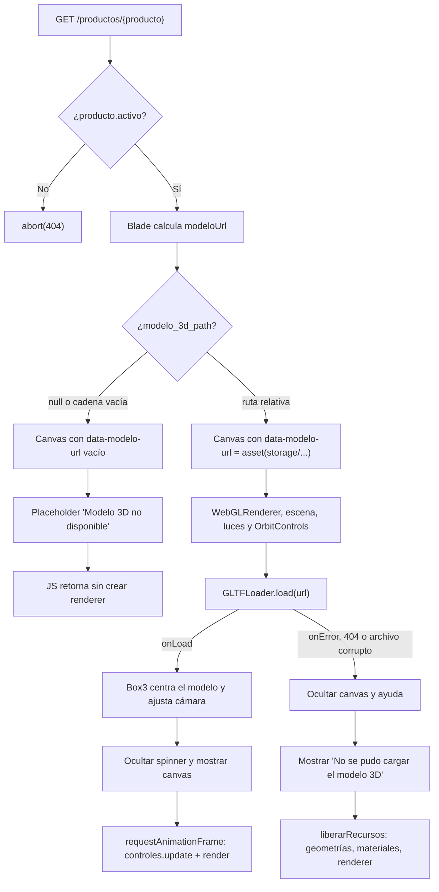
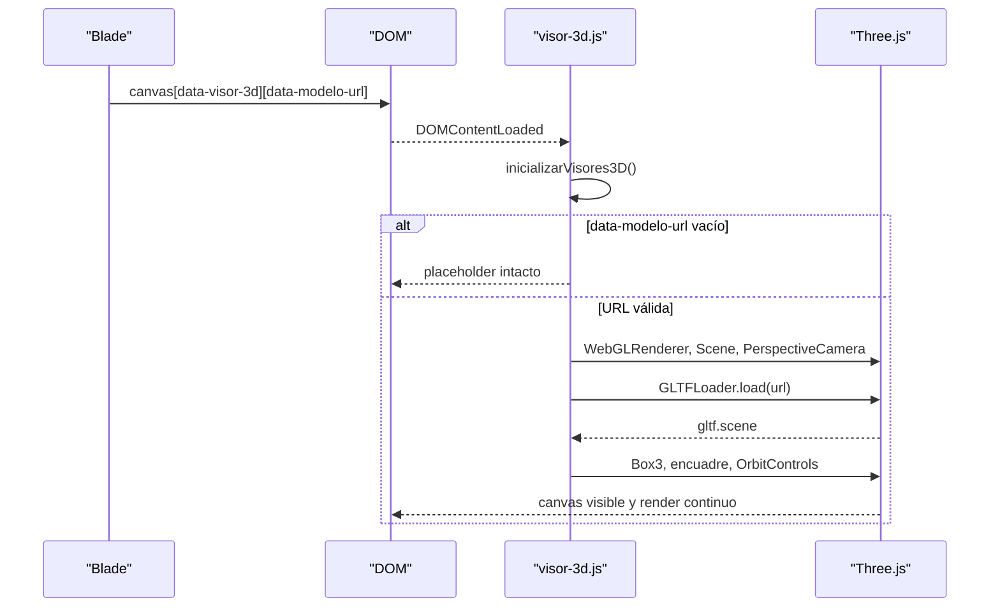

# 03 — Catálogo y visor 3D

Este documento describe el módulo público de catálogo y el visor interactivo de modelos 3D. Cubre **RF-02** (catálogo de productos con vista tridimensional), **RNF-01** (visor 3D interactivo y usable) y **RNF-02** (carga ágil de la ficha y del modelo, con objetivo de menos de 3 segundos).

El módulo sustituye la portada por el catálogo real: `GET /` ya no renderiza `welcome`, sino `productos.index`. La autenticación y el panel administrativo descritos en [02-roles-y-autenticacion.md](02-roles-y-autenticacion.md) siguen intactos.

## Alcance y requerimientos

| Requerimiento | Implementación actual |
| --- | --- |
| RF-02 — catálogo con imágenes/modelos 3D | Listado público de productos activos, ficha de detalle y visor Three.js para los productos que tengan `modelo_3d_path`. |
| RNF-01 — visor interactivo | Rotación con arrastre, zoom con rueda o pinza, encuadre automático, auto-rotación suave y estados alternativos accesibles. |
| RNF-02 — rendimiento | GLB como formato recomendado, servido como archivo estático desde `public/storage`, límite de *device pixel ratio* y liberación de recursos GPU. |

Fuera de alcance de este módulo: el CRUD administrativo de productos y la subida de archivos desde la interfaz, que se implementaron en el Módulo 4 y se documentan en [05-administracion.md](05-administracion.md). El carrito y el checkout se implementaron en el Módulo 3; el botón "Agregar al carrito" de la ficha ya envía un formulario real a `carrito.add`, documentado en [04-carrito-y-pedidos.md](04-carrito-y-pedidos.md).

## Componentes del módulo

| Componente | Archivo | Responsabilidad |
| --- | --- | --- |
| Catálogo | `app/Http/Controllers/ProductoController.php` (`index`) + `resources/views/productos/index.blade.php` | Lista productos activos con paginación de 9 y estado vacío. |
| Ficha de producto | `ProductoController::show` + `resources/views/productos/show.blade.php` | Detalle, estado de stock y contenedor del visor 3D. |
| Visor | `resources/js/visor-3d.js` | Inicializa Three.js sobre `[data-visor-3d]`, carga el GLB, gestiona cámara, luces, controles, errores y limpieza. |
| Punto de entrada JS | `resources/js/app.js` | Arranca Alpine y llama a `inicializarVisores3D()` al terminar el parseo del DOM. |
| Rutas | `routes/web.php` | `productos.index` y `productos.show`. |
| Datos semilla | `database/seeders/ProductoSeeder.php` | Tres cafés de ejemplo, sin imagen ni modelo 3D. |
| Pruebas | `tests/Feature/ProductoCatalogoTest.php` | Cobertura HTTP del catálogo, detalle, 404 y atributos del visor. |
| Navegación | `resources/views/layouts/navigation.blade.php` | Navbar sticky con enlace "Catálogo" y accesos según sesión/rol. |

`three@^0.187.0` se instala por NPM y se empaqueta con Vite; no se usa CDN. El visor importa `three` y, desde `three/addons`, `OrbitControls` y `GLTFLoader`.

## Arquitectura Blade → atributos `data-*` → JavaScript

La vista no contiene lógica de Three.js. Blade calcula la URL pública del modelo y la publica como atributos `data-*`; el script descubre los canvas y decide si debe renderizar.

```text
ProductoController::show
        │
        ▼
show.blade.php  ── calcula $modeloUrl = asset('storage/'.$producto->modelo_3d_path)
        │
        ▼
<canvas data-visor-3d data-modelo-url="…"> + estados HTML (spinner, placeholder, error)
        │
        ▼
app.js → inicializarVisores3D() → inicializarVisor(canvas)
        │
        ├── URL vacía → no se crea renderer; queda el placeholder del servidor
        └── URL válida → WebGLRenderer + GLTFLoader + OrbitControls + render loop
```

Consecuencias de este diseño:

- El HTML es útil sin JavaScript: el nombre, precio, stock y descripción están en la columna de texto y, si no hay modelo, el placeholder también se renderiza en el servidor.
- Un producto sin modelo no cuesta recursos: el script sale antes de construir el renderer.
- La URL se genera con `asset()`, por lo que depende de `APP_URL` y del symlink `public/storage`.
- El canvas lleva `data-modelo-alt`, pero el nombre accesible se resuelve con `aria-label` generado en Blade; el atributo queda como dato informativo.

## Flujo de render





## Rutas y controlador

| Método | URI | Nombre | Middleware | Acción |
| --- | --- | --- | --- | --- |
| GET | `/` | `productos.index` | web | `ProductoController@index` |
| GET | `/productos/{producto}` | `productos.show` | web | `ProductoController@show` con *route model binding* |

Definición en `routes/web.php`:

```php
Route::get('/', [ProductoController::class, 'index'])->name('productos.index');
Route::get('/productos/{producto}', [ProductoController::class, 'show'])->name('productos.show');
```

Comportamiento del controlador:

- `index()` filtra `where('activo', true)`, ordena por `categoria` y luego `nombre`, y pagina de 9 en 9 con `withQueryString()` para conservar query params en los enlaces de paginación. El índice compuesto `(activo, categoria)` respalda el filtro.
- `show()` recibe el `Producto` por binding implícito y ejecuta `abort_unless($producto->activo, 404)`. Un producto inactivo no se oculta con 403: simplemente no existe para el visitante.
- Un `id` inexistente también produce 404 mediante el binding.
- Las rutas son públicas; no requieren sesión.

## Las dos vistas

### Catálogo (`resources/views/productos/index.blade.php`)

- Contenedor `mx-auto max-w-7xl px-4 sm:px-6 lg:px-8` con cabecera editorial en tonos stone y ámbar.
- Grid responsivo: `grid grid-cols-1 sm:grid-cols-2 lg:grid-cols-3`, separación `gap-8`.
- Tarjeta: `rounded-2xl border border-stone-200 bg-white shadow-sm`, transición a `hover:-translate-y-0.5 hover:shadow-lg`.
- Imagen: relación `aspect-[4/3]`; si `imagen_path` existe se usa `object-cover` con `loading="lazy"`; si no, se pinta un degradado y un icono SVG de taza.
- Badge de categoría en la esquina superior izquierda y estado de stock ("Disponible"/"Agotado") en la derecha, ambos con `backdrop-blur-sm`.
- Precio formateado con `number_format((float) $producto->precio, 2)` y prefijo `S/`.
- Botón "Ver detalle" con `rounded-full` y anillo de foco `focus-visible:ring-amber-500`.
- Estado vacío cuando la colección no tiene elementos: tarjeta con borde discontinuo, icono y texto "El catálogo está en preparación".
- Paginación solo si `hasPages()`.
- La vista recibe `$productos`; no hay filtros por categoría en la UI todavía, aunque el orden y el índice están preparados para ello.

### Ficha (`resources/views/productos/show.blade.php`)

- Calcula en el bloque `@php` la URL del modelo y la disponibilidad (`stock > 0`).
- Rejilla principal: una columna y, desde `lg`, dos columnas (`lg:grid-cols-2`) con separación `lg:gap-12`.
- Contenedor del visor: `[data-visor-contenedor]` con `relative aspect-square w-full overflow-hidden rounded-2xl border border-stone-200 bg-stone-100`. El fondo stone actúa como lienzo neutro porque el renderer usa alpha transparente.
- Canvas `[data-visor-3d]` absoluto, `cursor-grab active:cursor-grabbing`, `opacity-0` hasta que el modelo carga, y `pointer-events-none` cuando no hay modelo.
- Estados superpuestos:
  - `[data-visor-cargando]`: spinner animado y texto "Cargando modelo 3D…".
  - `[data-visor-pista]`: chip "Vista 3D" solo si hay modelo.
  - `[data-visor-error]`: oculto por defecto; el JS lo muestra y lo pasa a `flex`.
  - Placeholder "Modelo 3D no disponible" con icono SVG cuando no hay `modelo_3d_path`.
- Ayuda `[data-visor-ayuda]`: "Arrastra para rotar · Rueda o pinza para hacer zoom", enlazada con `aria-describedby="visor-ayuda"`.
- Columna de información: badge de categoría, `h1`, descripción con fallback, precio, badge de disponibilidad, unidades en stock con `Str::plural`.
- Formulario real "Agregar al carrito" (`POST carrito.add`) si hay stock: cantidad numérica con `min="1"`, `max="{{ min($producto->stock, 10) }}"`, `@csrf` y `producto_id` oculto. El texto inferior indica cuántas unidades se pueden agregar. Si `stock = 0`, el botón "Agotado" queda deshabilitado y no envía nada. El flujo posterior está en [04-carrito-y-pedidos.md](04-carrito-y-pedidos.md#interfaz).
- Enlace "Volver al catálogo" a `productos.index`.

### Layout y navegación

- `layouts/app.blade.php`: `min-h-screen bg-stone-50 text-stone-800`, tipografía Instrument Sans autohospedada vía `@fonts` (plugin `laravel-vite-plugin/fonts` con Bunny) y `<title>` alimentado por el slot `title` de `x-app-layout`.
- `layouts/navigation.blade.php`: navbar `sticky top-0 z-50` con `bg-stone-50/80 backdrop-blur-md`, marca enlazada al catálogo, enlace "Catálogo" en escritorio y menú móvil, "Panel" solo autenticados y "Administración" solo administradores. Los invitados ven "Iniciar sesión" y "Crear cuenta". El menú móvil replica la lógica con `@auth` y `isAdmin()`.
- Ocultar "Administración" es solo cosmético; la autorización efectiva sigue en el middleware `role:admin` documentado en [02-roles-y-autenticacion.md](02-roles-y-autenticacion.md#mapa-de-rutas-y-protección).

## API del visor 3D

### Atributos `data-*`

| Atributo | Elemento | Uso |
| --- | --- | --- |
| `data-visor-3d` | `<canvas>` | Marcador que descubre el visor; el JS procesa cada coincidencia una sola vez. |
| `data-modelo-url` | `<canvas>` | URL absoluta del GLB. Vacía significa "sin modelo": no se inicializa WebGL. |
| `data-modelo-alt` | `<canvas>` | Nombre del producto; informativo, el texto accesible está en `aria-label`. |
| `data-visor-contenedor` | `<div>` padre | Ámbito donde el JS busca spinner, pista, error y ayuda; también se observa con `ResizeObserver`. |
| `data-visor-cargando` | `<div>` | Capa de carga que se oculta al terminar `onLoad`. |
| `data-visor-pista` | `<span>` | Chip "Vista 3D" que se oculta en error. |
| `data-visor-error` | `<div>` | Panel de error que el JS muestra y alterna a `flex`. |
| `data-visor-ayuda` | `<p>` | Texto de instrucciones; se oculta si falla la carga. |

No hay opciones por atributo para color, cámara o velocidad: la configuración es fija en `visor-3d.js` para mantener consistente la experiencia. Un producto por página es el caso previsto; el código soporta varios canvas porque itera sobre todos y usa un `WeakSet` para no inicializar dos veces.

### Interacción y cámara

- `OrbitControls` sobre el canvas: arrastre para rotar, rueda o pinza para zoom. `enablePan = false` evita desplazar el modelo fuera de cuadro.
- *Damping* activo (`0.08`), `rotateSpeed = 0.8`, `zoomSpeed = 0.9`.
- Auto-rotación a `0.6` salvo que el usuario prefiera menos movimiento (`prefers-reduced-motion: reduce`). La preferencia se lee una vez al inicializar.
- Cámara `PerspectiveCamera(35, 1, 0.1, 200)`. Al recibir el GLB, `Box3` obtiene tamaño y centro: el modelo se recentra en el origen y la distancia se calcula a partir de la dimensión mayor y el FOV, con un margen de `1.55`. Después se ajustan `near`, `far`, `minDistance` y `maxDistance`.
- Luces: ambiente blanca (`1.5`), direccional cálida (`0xfff2dd`, `2.6`) y direccional de relleno (`1.1`). Renderer con `ACESFilmicToneMapping`, exposición `1.15`, espacio `SRGBColorSpace` y fondo transparente.
- `ResizeObserver` sobre el contenedor más un listener de `resize`, para que el canvas siga el tamaño CSS (`aspect-square`).
- El loop usa `requestAnimationFrame`, actualiza controles y renderiza de forma continua mientras el documento siga vivo.

### Accesibilidad

- El canvas tiene `role="img"` y un `aria-label` que explica el producto y las interacciones.
- Con modelo, es enfocable (`tabindex="0"`) y referencia la ayuda con `aria-describedby`; sin modelo queda `aria-hidden="true"` y no recibe puntero.
- El contenido alternativo dentro del canvas cubre navegadores sin WebGL.
- El estado vacío y el de error son HTML real, no dependen de JavaScript para existir; el placeholder se renderiza en el servidor.
- Limitación conocida: el canvas es enfocable, pero no se registran controles por teclado; la rotación requiere puntero. La información esencial (nombre, precio, stock, descripción) está siempre en la columna de texto.

## Datos semilla y estado actual

`DatabaseSeeder` invoca `AdminUserSeeder` y después `ProductoSeeder`. Este último es idempotente (`updateOrCreate` por `nombre`) y crea:

| Producto | Precio | Stock | Categoría | `modelo_3d_path` | `imagen_path` |
| --- | --- | --- | --- | --- | --- |
| Espresso | 2.50 | 40 | Café | `null` | `null` |
| Latte | 3.80 | 35 | Café | `null` | `null` |
| Capuchino | 3.60 | 30 | Café | `null` | `null` |

El repositorio **no incluye archivos `.glb` ni `.gltf`**. Por tanto, tras `migrate --seed` el catálogo muestra las tarjetas con el degradado y la ficha muestra el placeholder "Modelo 3D no disponible". Esto es el comportamiento esperado, no un fallo.

> `ProductoSeeder` fuerza `modelo_3d_path` e `imagen_path` a `null` en cada ejecución. Si asignas rutas a estos tres productos y vuelves a ejecutar `php artisan db:seed`, las perderás. Para pruebas, usa otros productos o vuelve a asignar la ruta después del seed.

## Cómo cargar un modelo real

1. **Crear la carpeta pública de modelos** (aún no existe en una instalación limpia):

   ```bash
   mkdir -p storage/app/public/productos
   ```

2. **Copiar el archivo** con un nombre sin espacios ni caracteres especiales. Se recomienda GLB binario con texturas incrustadas:

   ```bash
   cp ~/Descargas/espresso.glb storage/app/public/productos/espresso.glb
   ```

   Recomendaciones de exportación:
   - GLB (un solo archivo) antes que glTF + `.bin` + texturas sueltas; así se evitan rutas relativas rotas.
   - Sin compresión Draco ni KTX2/meshopt: el visor solo registra `GLTFLoader`, sin `DRACOLoader` ni transcoder KTX2. Un GLB con Draco fallará al cargar.
   - Menos de 2–3 MB y unas decenas de miles de triángulos para cumplir el objetivo de carga de RNF-02.
   - Eje Y hacia arriba. La escala y el origen se normalizan automáticamente con `Box3`, pero un modelo con dimensiones absurdas puede perder precisión en `near`/`far`.

3. **Asegurar el symlink público** (si ya existe, el comando lo indica y no hace falta recrearlo):

   ```bash
   php artisan storage:link
   ```

   El symlink requerido es `public/storage → storage/app/public`. Está en `.gitignore`, así que debe crearse en cada entorno.

4. **Guardar la ruta relativa en la base de datos**. No incluyas el prefijo `storage/` ni una barra inicial: Blade lo antepone.

   ```bash
   php artisan tinker --execute 'App\Models\Producto::where("nombre", "Espresso")->update(["modelo_3d_path" => "productos/espresso.glb"]);'
   ```

   Equivalente por SQL:

   ```sql
   UPDATE productos SET modelo_3d_path = 'productos/espresso.glb' WHERE nombre = 'Espresso';
   ```

5. **Verificar que el archivo se sirve**:

   ```bash
   ls -l public/storage
   curl -I http://127.0.0.1:8000/storage/productos/espresso.glb
   ```

   La respuesta debe ser `200` con `Content-Type` de modelo (habitualmente `model/gltf-binary`) o `application/octet-stream`; un `404` indica symlink, ruta o nombre incorrectos.

6. **Recargar la ficha** `/productos/{id}`. Si el navegador conservó el HTML anterior, fuerza recarga. Con `npm run dev` los cambios de Blade se reflejan al instante; si modificaste JS, Vite recarga la página. En producción ejecuta `npm run build`.

La asignación manual por consola es posible, pero el CRUD con subida de archivos desde la interfaz corresponde al Módulo 4 ([05-administracion.md](05-administracion.md#crud-de-productos-rf-05)). La ruta también puede fijarse desde la factory en pruebas (`modelo_3d_path` explícito), como hace `ProductoCatalogoTest`.

## Manejo de errores

| Situación | Detección | Resultado visible |
| --- | --- | --- |
| Producto inactivo | `abort_unless($producto->activo, 404)` | Página 404 de Laravel. |
| `modelo_3d_path` nulo o vacío | Blade y comprobación de URL en JS | Placeholder "Modelo 3D no disponible"; no se crea renderer. |
| WebGL no disponible o el contexto falla | `try/catch` al construir `WebGLRenderer` | Canvas oculto y panel "No se pudo cargar el modelo 3D". |
| GLB con 404, CORS o archivo corrupto | Callback de error de `GLTFLoader` | Se ocultan canvas, spinner, pista y ayuda; se muestra el panel de error y se liberan recursos. |
| Excepción al calcular `Box3` o montar la escena | `try/catch` en `onLoad` | Mismo panel de error y limpieza. |
| Cambio de tamaño | `ResizeObserver` y evento `resize` | Se recalcula aspecto y tamaño del renderer. |
| Salida de la página o *back/forward cache* | `pagehide` | `dispose()` de geometrías, materiales, texturas, controles y renderer; `forceContextLoss()`. |

El panel de error es un estado terminal: no hay reintento automático. El texto pide recargar o volver más tarde. Las texturas y geometrías se liberan incluso si el modelo quedó a medio construir, porque el recorrido de la escena está envuelto en `try/catch`.

## Rendimiento y limitaciones

- **Three.js se importa estáticamente** desde `app.js`, así que el bundle incluye Three.js en todas las páginas, aunque no haya visor. El build actual ronda **694 kB (178 kB gzip)** para `app.js` y Vite advierte por el umbral de 500 kB. Optimización futura: `import()` dinámico de `visor-3d.js` solo cuando exista un `[data-modelo-url]` no vacío, o separar Three.js en un chunk manual. No se ha aplicado para no alterar el arranque actual.
- Un solo renderer por ficha; no hay escenas compartidas ni instancing. El caso de uso es una ficha con un producto.
- `setPixelRatio` se limita a `2`, lo que reduce el coste en pantallas de alta densidad.
- El loop de render es continuo mientras la página está viva (necesario para damping y auto-rotación). No se pausa de forma explícita al ocultar la pestaña ni al hacer scroll fuera de vista; sería una mejora con `IntersectionObserver` o `visibilitychange`.
- El modelo se sirve como archivo estático a través del symlink; no hay control de acceso ni URLs firmadas. Es adecuado para catálogo público.
- No hay compresión Draco, KTX2 ni meshopt, ni generación de LOD o *fallback* geométrico. La calidad del GLB es responsabilidad del archivo que se suba.
- No hay precarga del modelo ni *skeleton* con progreso porcentual: el spinner es indeterminado.
- La auto-rotación solo respeta `prefers-reduced-motion` en el momento de inicializar; un cambio en caliente de la preferencia no se detecta.
- Si JavaScript no se ejecuta en una ficha que sí tiene modelo, el spinner HTML permanece visible y el canvas nunca aparece; el contenido textual de la ficha sigue siendo legible.
- El listado no filtra por categoría en la interfaz ni carga imágenes reales de los productos semilla; la estructura y el índice están preparados.
- No hay medición automatizada ni presupuesto de rendimiento en CI: el objetivo de menos de 3 segundos de RNF-02 no está instrumentado. Los factores determinantes son el peso del bundle de Three.js y el tamaño del GLB.
- El botón de carrito está deshabilitado si `stock = 0`; con stock, envía el formulario real a `carrito.add` (Módulo 3). El límite de 10 unidades del input es solo de interfaz: el servidor valida contra el stock disponible.

## Pruebas

```bash
# Solo el módulo de catálogo
php artisan test --filter=ProductoCatalogoTest

# Suite completa
php artisan test --compact
```

Cobertura de `tests/Feature/ProductoCatalogoTest.php`:

| Prueba | Escenario | Resultado esperado |
| --- | --- | --- |
| `test_el_catalogo_solo_muestra_productos_activos` | Un producto activo y otro inactivo. | El activo aparece; el inactivo no. |
| `test_el_detalle_muestra_un_producto_activo` | Ficha de un producto activo. | `200`, nombre visible y botón "Agregar al carrito". |
| `test_el_detalle_devuelve_404_para_un_producto_inactivo` | Ficha de un producto inactivo. | `404`. |
| `test_el_detalle_incluye_el_visor_3d_con_la_url_del_modelo` | Producto con `modelo_3d_path`. | `data-visor-3d`, `data-modelo-url` con `asset('storage/...')` y sin placeholder. |
| `test_el_detalle_muestra_el_estado_vacio_cuando_no_hay_modelo` | Producto sin modelo. | `data-modelo-url=""` y texto "Modelo 3D no disponible". |

Estado global verificado: **48 pruebas aprobadas, 172 aserciones**, incluidas las 8 pruebas de carrito y las 7 de pedidos del Módulo 3. Las pruebas de este documento son HTTP y no ejecutan WebGL: validan el HTML y los atributos que consume el visor, no el render en navegador.

### Assets: desarrollo y producción

```bash
# Desarrollo con recarga en caliente (Vite dev server)
npm run dev

# Build de producción; Laravel consume public/build/manifest.json
npm run build
```

`public/build` está en `.gitignore`, por lo que el build debe generarse en cada entorno. Si la ficha no refleja un cambio de Blade o aparece el error de Vite "Unable to locate file in Vite manifest", regenera el build o mantén `npm run dev` activo.

### Verificación manual sugerida

1. `npm install && npm run dev` y, en otra terminal, `php artisan serve`.
2. Abrir `http://127.0.0.1:8000/` y comprobar el grid en 375 px, 768 px y 1280 px.
3. Entrar a un producto semilla: debe verse el placeholder, sin spinner ni errores en consola.
4. Cargar un GLB siguiendo la guía anterior y recargar: spinner, aparición del modelo y auto-rotación.
5. Arrastrar, usar rueda y pinza; comprobar que el paneo está desactivado y que el zoom tiene límites.
6. Renombrar temporalmente el GLB para provocar un 404: debe aparecer "No se pudo cargar el modelo 3D" y desaparecer el canvas.
7. En DevTools, emular `prefers-reduced-motion: reduce` y recargar: el modelo no debe auto-rotar.
8. Marcar un producto como inactivo (`activo => false`) y abrir su URL: debe responder 404.

## Referencias

- Esquema de `productos` y convención de rutas de archivos: [01-base-de-datos.md](01-base-de-datos.md#productos).
- Autenticación, roles y protección de `/admin`: [02-roles-y-autenticacion.md](02-roles-y-autenticacion.md).
- Carrito y checkout que consumen el catálogo: [04-carrito-y-pedidos.md](04-carrito-y-pedidos.md).
- Puesta en marcha y estado general: [README.md](README.md).
