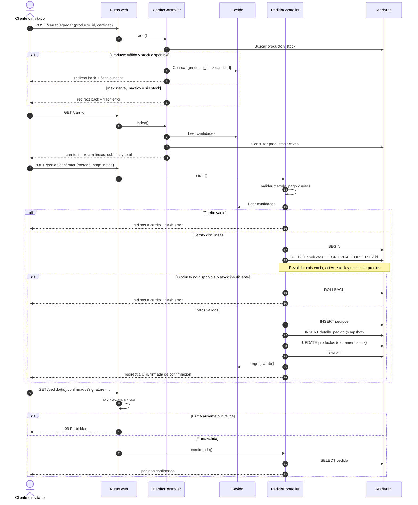

# 04 — Carrito y pedidos

Este documento describe el módulo de compra: el carrito de sesión y la confirmación transaccional de pedidos. Cubre **RF-03** (carrito de compras) y **RF-04** (registro del pedido). El flujo es público: un invitado puede agregar productos y confirmar sin crear cuenta; un usuario autenticado obtiene además la asociación del pedido a su cuenta.

El módulo se apoya en el catálogo descrito en [03-catalogo-y-visor-3d.md](03-catalogo-y-visor-3d.md) y en las tablas `pedidos` y `detalle_pedido` documentadas en [01-base-de-datos.md](01-base-de-datos.md#pedidos). No se modificó el esquema de autenticación de [02-roles-y-autenticacion.md](02-roles-y-autenticacion.md).

## Alcance y requerimientos

| Requerimiento | Implementación actual |
| --- | --- |
| RF-03 — carrito de compras | Carrito almacenado en la sesión con estructura `[producto_id => cantidad]`; agregar, restar, quitar y vaciar; precios y subtotales recalculados desde la base de datos en cada vista. |
| RF-04 — registro del pedido | Checkout con método de pago y notas; creación de `pedidos` y `detalle_pedido` dentro de una transacción; descuento de stock; confirmación con URL firmada. |

Fuera de alcance de este módulo:

- Pasarela de pago real. `metodo_pago` registra una preferencia; el cobro se resuelve en tienda.
- Historial de pedidos para el cliente y gestión administrativa de pedidos (Módulo 4).
- Reserva de stock: el stock solo se descuenta al confirmar el pedido.
- Persistencia del carrito entre dispositivos o tras cerrar sesión.

## Componentes del módulo

| Componente | Archivo | Responsabilidad |
| --- | --- | --- |
| Carrito | `app/Carrito.php` | Lee, normaliza, resuelve y modifica el carrito de sesión. |
| Controlador del carrito | `app/Http/Controllers/CarritoController.php` | `index`, `add`, `remove`, `clear`; valida producto, estado y stock. |
| Controlador de pedidos | `app/Http/Controllers/PedidoController.php` | `store` (checkout transaccional) y `confirmado` (vista firmada). |
| Enum de pago | `app/Enums/MetodoPago.php` | Valores `efectivo`, `tarjeta`, `transferencia`. |
| Modelos | `app/Models/Pedido.php`, `app/Models/DetallePedido.php` | Relaciones, `#[Fillable]` y casts (`estado`, `metodo_pago`, importes). |
| Rutas | `routes/web.php` | Rutas públicas de carrito y pedidos. |
| Vista del carrito | `resources/views/carrito/index.blade.php` | Líneas, resumen, método de pago, notas y confirmación. |
| Vista de confirmación | `resources/views/pedidos/confirmado.blade.php` | Número, total, método y mensaje para invitados. |
| Mensajes flash | `resources/views/components/flash-banner.blade.php` | Banner global de éxito/error incluido en el layout. |
| Navegación | `resources/views/layouts/navigation.blade.php` | Icono de carrito con contador en escritorio y móvil. |
| Migración | `database/migrations/2026_11_08_163735_add_metodo_pago_and_allow_guest_user_to_pedidos_table.php` | Hace `pedidos.user_id` nullable y agrega `metodo_pago`. |
| Pruebas | `tests/Feature/CarritoTest.php`, `tests/Feature/PedidoTest.php` | Cobertura HTTP del carrito y del checkout. |

## Carrito en la sesión

### Estructura

La sesión guarda únicamente identificadores y cantidades bajo la clave `carrito`:

```php
// Contenido de session('carrito')
[
    12 => 2, // producto_id => cantidad
    7  => 1,
]
```

`Carrito::cantidades()` normaliza el arreglo: descarta claves o cantidades no positivas y convierte los valores a entero. Si la sesión no contiene un arreglo válido, devuelve `[]`. No se guardan nombres, precios, subtotales ni stock.

`Carrito::lineas()` resuelve las líneas contra la base de datos:

1. Consulta los productos con `whereIn('id', ...)->where('activo', true)`.
2. Purga de la sesión los productos inactivos o eliminados mediante `purgarNoDisponibles()`.
3. Devuelve una colección con `producto`, `cantidad`, `precio_unitario` y `subtotal`, calculados con el precio actual de `productos.precio`.

| Método | Entrada | Efecto |
| --- | --- | --- |
| `cantidades()` | — | Devuelve `array<int, int>` normalizado. |
| `lineas()` | — | Devuelve las líneas con datos y precios actuales; purga productos no disponibles. |
| `agregar($productoId, $cantidad)` | IDs y cantidad positivos | Suma unidades a la línea existente o la crea. |
| `quitar($productoId, $cantidad = null)` | Sin cantidad elimina la línea; con cantidad resta unidades y elimina si el resto es cero o negativo. | Modifica la sesión. |
| `vaciar()` | — | Ejecuta `session()->forget('carrito')`. |

### Por qué no existe una tabla de carrito

El carrito es un estado efímero de la compra, no un registro de negocio. Mantenerlo en sesión aporta:

- **Sin tabla de negocio**: cada clic modifica un arreglo en la sesión; no se insertan ni actualizan filas de carrito. La sesión se persiste según `SESSION_DRIVER` (en este proyecto, `database`).
- **Sin duplicación de la verdad**: el precio y el stock viven solo en `productos`; el carrito no puede fijar una copia obsoleta de los importes.
- **Sin limpieza de carritos abandonados**: no hay filas huérfanas que purgar.
- **Compatibilidad con invitados**: la sesión ya identifica al visitante sin exigir una cuenta.

El proyecto usa `SESSION_DRIVER=database`, por lo que la sesión se persiste en la tabla `sessions`; aun así, no existe una tabla de carrito con semántica de negocio.

Contrapartidas asumidas:

- El carrito no se comparte entre dispositivos ni navegadores.
- Se pierde al cerrar sesión: el logout de Breeze ejecuta `session()->invalidate()`. En cambio, el login y el registro solo regeneran el ID de sesión, por lo que el carrito de un invitado sobrevive si decide crear una cuenta antes de confirmar.
- No hay analítica de carritos abandonados.
- Si en el futuro se requiere persistencia por usuario, habría que añadir tablas `carritos`/`carrito_items` y migrar la sesión.

## Rutas

Todas las rutas son públicas (`web`); no exigen autenticación. La única protección adicional es la firma de la confirmación.

| Método | URI | Nombre | Middleware | Acción |
| --- | --- | --- | --- | --- |
| GET | `/carrito` | `carrito.index` | `web` | `CarritoController@index` |
| POST | `/carrito/agregar` | `carrito.add` | `web` | `CarritoController@add` |
| POST | `/carrito/quitar` | `carrito.remove` | `web` | `CarritoController@remove` |
| POST | `/carrito/vaciar` | `carrito.clear` | `web` | `CarritoController@clear` |
| POST | `/pedido/confirmar` | `pedidos.store` | `web` | `PedidoController@store` |
| GET | `/pedido/{pedido}/confirmado` | `pedidos.confirmado` | `web`, `signed` | `PedidoController@confirmado` |

Todas las operaciones de escritura usan `POST` y los formularios incluyen `@csrf`. No hay rutas `PUT`/`DELETE`: agregar, restar, quitar y vaciar se expresan como envíos de formulario.

## Flujo de checkout



Resumen del camino feliz:

1. El cliente agrega unidades desde la ficha o desde el propio carrito.
2. `GET /carrito` reconstruye las líneas con precios actuales y muestra el resumen.
3. `POST /pedido/confirmar` valida pago y notas, y comprueba que el carrito no esté vacío.
4. Dentro de una transacción se bloquean los productos, se revalida stock y se calcula el total.
5. Se insertan cabecera y detalles, se descuenta stock y se confirma la transacción.
6. Se vacía la sesión y se redirige a una URL firmada con el número de pedido.

## Stock, precios y totales

### Frontera de confianza

El navegador solo envía `producto_id` y `cantidad` (o `metodo_pago` y `notas`). **Nunca** se acepta un precio, subtotal ni total desde el cliente. El servidor resuelve el producto y calcula los importes con `productos.precio`.

### Validaciones por etapa

| Etapa | Archivo | Comprobaciones |
| --- | --- | --- |
| Agregar | `CarritoController@add` | `producto_id` entero y existente; `cantidad` entero ≥ 1; producto activo; `stock > 0`; `cantidad ≤ stock - unidades ya en carrito`. |
| Ver carrito | `Carrito::lineas()` | Solo productos activos; purga inactivos/eliminados de la sesión; recalcula precio y subtotal actuales. No recorta cantidades al stock actual. |
| Confirmar | `PedidoController@store` | Carrito no vacío; producto existente; producto activo; `stock ≥ cantidad`; método de pago permitido; notas ≤ 500 caracteres. |
| Persistencia | Transacción | `lockForUpdate()` sobre los productos ordenados por `id`; inserción de cabecera/detalles; `decrement('stock', $cantidad)`. |

Detalles relevantes:

- **Stock al agregar**: se descuenta lo que ya está en el carrito antes de comparar. Si un producto tiene stock 3 y el carrito ya tiene 2, solo se puede agregar 1 unidad más.
- **Stock al confirmar**: aunque el carrito se haya construido con stock válido, otro pedido pudo consumirlo. Por eso se vuelve a validar dentro de la transacción.
- **Bloqueo ordenado**: `orderBy('id')->lockForUpdate()` bloquea las filas en un orden consistente para reducir el riesgo de interbloqueos entre checkouts concurrentes.
- **Productos retirados**: si un producto se desactiva o elimina después de agregarlo, `lineas()` lo purga al abrir el carrito. Si la sesión aún lo contiene al confirmar, el checkout lanza un error de validación y no crea nada.
- **Cantidades no recortadas**: el carrito puede contener una cantidad superior al stock actual si el stock bajó después de agregar. La vista lo advierte con “Has alcanzado el stock disponible” y el checkout lo rechaza; no se modifica la sesión silenciosamente.
- **Límite de 10 unidades**: la ficha aplica `max="{{ min($producto->stock, 10) }}"` como límite de interfaz. El servidor no impone ese tope: valida únicamente contra el stock disponible. Un envío manipulado puede agregar más de 10 unidades si hay stock.
- **Redondeo**: cada subtotal se calcula como `round($precioUnitario * $cantidad, 2)`; el total es la suma de subtotales redondeada a dos decimales. La persistencia usa `decimal(10,2)`.

### Transacción y atomicidad

`PedidoController@store` envuelve la creación completa en `DB::transaction()`. Si cualquier producto falla la revalidación, se lanza `ValidationException`; la transacción se revierte y no quedan pedidos, detalles ni descuentos de stock parciales. La sesión conserva el carrito para que el cliente pueda corregirlo.

La cabecera se crea con `EstadoPedido::Pendiente`, el `user_id` de `auth()->id()` (o `NULL` para invitados), el `metodo_pago` validado, el total calculado y las notas opcionales. Los detalles se insertan con `createMany()` y el stock se descuenta con `decrement()` dentro de la misma transacción.

Las únicas excepciones capturadas son las de validación. Un fallo de base de datos distinto (por ejemplo, una conexión caída) se propaga como error 500, pero la transacción garantiza que no deja escrituras a medias.

## Invitado frente a autenticado

| Aspecto | Invitado | Autenticado |
| --- | --- | --- |
| Agregar y ver carrito | Sí, con la sesión anónima. | Sí, misma clave de sesión. |
| Confirmar pedido | Sí. | Sí. |
| `pedidos.user_id` | `NULL`. | `auth()->id()`. |
| Mensaje de confirmación | “Pedido registrado como invitado.” | “Pedido registrado correctamente.” |
| Aviso en la vista | “Guarda tu número de pedido para consultarlo en tienda.” | No se muestra. |
| Botón “Ver mi panel” | No. | Sí, enlace a `dashboard`. |
| Acceso a la confirmación | URL firmada. | URL firmada; no se comprueba la propiedad del pedido. |
| Historial de pedidos | No existe todavía. | No existe todavía. |

La decisión de permitir checkout sin login evita fricción en una cafetería y mantiene el flujo de Breeze como opcional. Para soportarlo, `pedidos.user_id` pasó a ser nullable conservando la FK `RESTRICT`: un pedido de invitado no tiene usuario, pero sigue siendo imposible borrar una cuenta con pedidos asociados.

Consecuencias:

- `User::pedidos()` solo devuelve pedidos con `user_id`; los pedidos de invitados no aparecen en ninguna relación de usuario.
- No se puede identificar al invitado más allá de la URL firmada de confirmación.
- La vista de confirmación es deliberadamente genérica: no muestra líneas, notas ni datos personales.

## Método de pago y notas

El método de pago se modela con `App\Enums\MetodoPago`:

| Caso | Valor persistido | Etiqueta en la vista |
| --- | --- | --- |
| `MetodoPago::Efectivo` | `efectivo` | Efectivo |
| `MetodoPago::Tarjeta` | `tarjeta` | Tarjeta |
| `MetodoPago::Transferencia` | `transferencia` | Transferencia |

- `PedidoController@store` valida `metodo_pago` con `required|in:efectivo,tarjeta,transferencia`.
- La UI preselecciona `efectivo` mediante `old('metodo_pago', 'efectivo')` y recorre `MetodoPago::cases()`.
- `pedidos.metodo_pago` es `varchar(255)` con default `'efectivo'`; el modelo lo castea a `MetodoPago`, por lo que `$pedido->metodo_pago` es un enum y la vista usa `->value`.
- No hay cobro ni integración con pasarela: es una preferencia para preparar el pedido y cobrar en tienda.
- `notas` es opcional (`nullable|string|max:500`). Blade escapa el contenido al mostrarlo; la vista de confirmación no las muestra.
- La columna `notas` es `TEXT`; el límite de 500 es una regla de aplicación, no del esquema.

## Snapshot de precios

`detalle_pedido` guarda una copia del precio y del subtotal al momento de la compra:

| Columna | Origen |
| --- | --- |
| `producto_id` | Producto del carrito. |
| `cantidad` | Cantidad de la sesión. |
| `precio_unitario` | `productos.precio` en el momento del checkout. |
| `subtotal` | `cantidad × precio_unitario`, redondeado a dos decimales. |

El total del pedido se consolida en `pedidos.total`. Así, un cambio posterior de precio no altera el importe histórico. Ejemplo: 3 unidades de un producto de S/ 12.50 generan un detalle con `precio_unitario = 12.50`, `subtotal = 37.50` y un pedido con `total = 37.50`.

La sesión nunca almacena estos importes; el snapshot se crea únicamente al confirmar, con los valores leídos dentro de la transacción.

## Confirmación firmada

Tras el checkout, el controlador redirige a:

```php
URL::signedRoute('pedidos.confirmado', ['pedido' => $pedido->getKey()])
```

La ruta `GET /pedido/{pedido}/confirmado` lleva el middleware `signed`. Comportamiento:

- Firma ausente o inválida: `403 Forbidden`, incluso si el `id` no existe (el middleware se ejecuta antes del controlador).
- Firma válida: `PedidoController@confirmado` busca el pedido con `findOrFail`; un `id` inexistente con firma válida produce `404`.
- La URL no caduca: se usa `signedRoute`, no `temporarySignedRoute`.
- La firma demuestra que la URL fue generada por la aplicación, **no** que el visitante sea el dueño del pedido. Quien tenga el enlace puede ver número, total y método de pago. Por eso la vista no incluye detalles, notas ni datos del cliente.
- No se exige login para ver la confirmación; es coherente con el checkout de invitado.

La vista muestra:

- Número de pedido (`#{{ $pedido->id }}`).
- Total formateado (`S/ {{ number_format((float) $pedido->total, 2) }}`).
- Método de pago con inicial mayúscula (`ucfirst($pedido->metodo_pago->value)`).
- Aviso de pedido como invitado si `user_id === null`.
- Botón “Volver al catálogo” y, solo para usuarios autenticados, “Ver mi panel”.

## Manejo de errores

| Situación | Detección | Resultado |
| --- | --- | --- |
| Producto inexistente al agregar | `exists:productos,id` | Error de validación en `producto_id`; el banner muestra el primer error. |
| Producto inactivo al agregar | Comprobación de `activo` | `redirect back` con flash `error`; no se modifica el carrito. |
| Stock insuficiente al agregar | `stock - enCarrito` | `redirect back` con mensaje “No hay stock suficiente…”; indica el máximo disponible. |
| Producto agotado al agregar | `stock <= 0` o disponible `<= 0` | Flash de error; el carrito queda intacto. |
| Cantidad inválida | Validación `integer` + `min:1` | Redirección con errores de validación; el layout muestra el primer error. |
| Carrito vacío al confirmar | `cantidades() === []` | Redirect a `carrito.index` con flash de error. |
| Producto eliminado al confirmar | `$productos->get($id) === null` | `ValidationException` → rollback → redirect al carrito con error. |
| Producto inactivo al confirmar | `! $producto->activo` | `ValidationException` → rollback → redirect al carrito con error. |
| Stock insuficiente al confirmar | `$producto->stock < $cantidad` | `ValidationException` → rollback → redirect al carrito con error; el carrito se conserva. |
| Método de pago inválido | `in:efectivo,tarjeta,transferencia` | Error de validación; no se crea pedido. |
| Notas demasiado largas | `max:500` | Error de validación; no se crea pedido. |
| URL de confirmación sin firma | Middleware `signed` | `403 Forbidden`. |
| Pedido inexistente con firma válida | `findOrFail` | `404 Not Found`. |
| Fallo de base de datos | Excepción no capturada | `500`; la transacción revierte. |

Los errores de checkout se devuelven con `with('error', ...)` y `withErrors(...)`, de modo que el banner global y el formulario pueden mostrar el mensaje. El carrito no se vacía ante un fallo.

## Interfaz

### Carrito (`resources/views/carrito/index.blade.php`)

- Estética stone/amber coherente con el catálogo: tarjetas `rounded-2xl`, bordes `stone-200`, acentos `amber-600`.
- Cabecera con enlace “Volver al catálogo”, título “Tu carrito”, contador de unidades y botón “Vaciar carrito” solo si hay líneas.
- Estado vacío con borde discontinuo, icono de taza, mensaje y botón “Explorar el catálogo”.
- Rejilla de dos columnas desde `lg`: líneas a la izquierda y resumen sticky (`lg:sticky lg:top-24`) a la derecha.
- Cada línea muestra imagen o degradado, nombre enlazado a la ficha, precio unitario, subtotal y aviso si se alcanzó el stock.
- Control de cantidad con dos formularios `POST`: uno resta 1 (`carrito.remove` con `cantidad=1`) y otro suma 1 (`carrito.add`). El botón “+” se deshabilita cuando `cantidad >= stock`.
- Botón “Quitar” que elimina la línea completa (`carrito.remove` sin `cantidad`).
- Resumen: subtotal, “Recojo en tienda” como envío y total; ambos importes se recalculan en el servidor.
- Formulario de checkout con radios de método de pago en tarjetas (`has-[:checked]`), notas con `maxlength="500"` y botón “Confirmar pedido”.
- Enlace “Seguir comprando” al catálogo.

### Contador del navbar (`layouts/navigation.blade.php`)

- El icono del carrito aparece para invitados y autenticados, en escritorio y en el menú móvil.
- El badge ámbar muestra la suma de cantidades de la sesión (`array_sum`), con tope visual `99+`.
- El atributo `data-carrito-contador` expone el valor para las pruebas HTTP.
- El contador lee la sesión cruda, no `Carrito::lineas()`: un producto inactivo o eliminado puede seguir sumando hasta que se abra `/carrito` y se purgue la sesión.

### Ficha de producto (`productos/show.blade.php`)

- Si `stock > 0`, renderiza un formulario real a `carrito.add` con `@csrf`, `producto_id` oculto y cantidad numérica.
- `max` del input es `min(stock, 10)` y el texto inferior indica “Puedes agregar hasta N unidades por pedido”.
- Si `stock = 0`, el botón “Agotado” queda deshabilitado y no se envía nada.
- Los errores de validación de `cantidad` se muestran bajo el formulario.

### Confirmación (`pedidos/confirmado.blade.php`)

- Tarjeta centrada con icono de check, título “¡Gracias por tu pedido!” y tres bloques: pedido, total y método de pago.
- Aviso ámbar para invitados.
- Acciones: “Volver al catálogo” siempre; “Ver mi panel” solo con `@auth`.

### Mensajes flash (`components/flash-banner.blade.php`)

- Incluido globalmente en `layouts/app.blade.php`, después de la navegación.
- Muestra `session('success')` en un banner ámbar y `session('error')` en un banner neutro con icono rojo.
- Si no hay `error` explícito pero existen errores de validación, muestra el primero (`$errors->first()`).
- Usa `role="status"`/`aria-live` para el éxito y `role="alert"` para el error.

## Pruebas

```bash
# Carrito
php artisan test --filter=CarritoTest

# Pedidos y confirmación
php artisan test --filter=PedidoTest

# Suite completa
php artisan test --compact
```

Cobertura de `tests/Feature/CarritoTest.php` (8 pruebas):

| Prueba | Escenario | Resultado esperado |
| --- | --- | --- |
| `test_agregar_un_producto_actualiza_la_sesion_y_el_contador` | Agregar 2 unidades desde la ficha. | Sesión `[id => 2]`, flash de éxito y badge `data-carrito-contador="2"`. |
| `test_no_permite_agregar_mas_unidades_de_las_disponibles` | Stock 3, carrito con 2, intento de 2 más. | Flash de error y carrito intacto en 2. |
| `test_rechaza_un_producto_inactivo` | Producto con `activo = false`. | Flash de error; no se agrega. |
| `test_la_cantidad_debe_ser_al_menos_uno` | `cantidad = 0`. | Error de validación en `cantidad`. |
| `test_quitar_una_unidad_y_eliminar_la_linea_completa` | Restar 1 y luego quitar sin cantidad. | Pasa de 3 a 2 y luego la sesión queda vacía. |
| `test_vaciar_el_carrito` | `POST /carrito/vaciar`. | Sesión `null` y flash de éxito. |
| `test_el_carrito_ignora_productos_inactivos_o_eliminados` | Sesión con un activo, un inactivo y un ID inexistente. | Solo se muestra el activo y la sesión se purga. |
| `test_el_contador_del_navbar_suma_las_cantidades` | Dos productos con 2 y 3 unidades. | Badge `data-carrito-contador="5"`. |

Cobertura de `tests/Feature/PedidoTest.php` (7 pruebas):

| Prueba | Escenario | Resultado esperado |
| --- | --- | --- |
| `test_confirmar_crea_un_pedido_pendiente_con_detalles_y_descuenta_stock` | Usuario autenticado, 3 unidades, pago con tarjeta y notas. | Pedido `pendiente`, total `37.50`, detalle con snapshot, stock descontado y sesión vacía; redirección firmada. |
| `test_un_invitado_puede_confirmar_y_el_pedido_queda_sin_usuario` | Checkout sin autenticación, pago efectivo. | `user_id = null`, total `8.00`, stock descontado y aviso de invitado en la confirmación. |
| `test_stock_insuficiente_no_crea_pedido_ni_descuenta_stock` | Carrito con 5 unidades y stock 2. | Error, cero pedidos/detalles, stock intacto y carrito conservado. |
| `test_un_producto_inactivo_en_el_carrito_bloquea_la_confirmacion` | Producto inactivo en la sesión. | Error, sin pedido y sin descuento. |
| `test_metodo_pago_invalido_falla_la_validacion` | `metodo_pago = bitcoin`. | Error de validación, sin pedido ni descuento. |
| `test_no_se_puede_confirmar_con_el_carrito_vacio` | Checkout sin líneas. | Redirect al carrito con flash de error; cero pedidos. |
| `test_la_confirmacion_requiere_una_url_firmada` | Confirmación sin firma y con firma para un ID inexistente. | `403` en ambos casos; con firma válida muestra número, total y método. |

Estado global verificado de la suite: **48 pruebas aprobadas y 172 aserciones**. Las pruebas son HTTP y no ejecutan JavaScript: validan sesión, base de datos, redirecciones, firmas y HTML; el comportamiento visual del carrito y del badge debe comprobarse en navegador.

## Verificación manual

1. Preparar el entorno:

   ```bash
   php artisan migrate --seed
   npm install
   npm run dev
   php artisan serve
   ```

   Si no se usa Vite en modo desarrollo, ejecutar `npm run build`.

2. Abrir `http://127.0.0.1:8000/`, entrar a un producto con stock y agregar 2 unidades. Debe aparecer el banner de éxito y el badge del navbar en `2`.

3. Abrir `/carrito`: comprobar líneas, subtotal, total, botones `+`/`−`, “Quitar” y “Vaciar carrito”. El botón `+` debe deshabilitarse al alcanzar el stock.

4. Como invitado, elegir método de pago, escribir una nota y confirmar. Debe redirigir a `/pedido/{id}/confirmado?signature=...`, mostrar número, total, método y el aviso “Pedido registrado como invitado”.

5. Verificar en base de datos que el pedido tiene `user_id NULL`, estado `pendiente`, total correcto y detalles con `precio_unitario`/`subtotal`. Comprobar que el stock bajó:

   ```bash
   php artisan tinker --execute 'App\Models\Pedido::latest("id")->first()->load("detallesPedido");'
   ```

6. Repetir el checkout con la cuenta `cliente@cafeteria.test` / `password`. El pedido debe tener `user_id`, y la confirmación debe mostrar “Pedido registrado correctamente” y el botón “Ver mi panel”.

7. Provocar stock insuficiente: agregar 2 unidades, reducir el stock a 1 con tinker y confirmar. Debe volver al carrito con error, sin pedido y sin descuento; el carrito debe conservar las 2 unidades.

8. Provocar producto no disponible: desactivar un producto que esté en el carrito y abrir `/carrito`. La línea debe desaparecer y la sesión purgarse.

9. Abrir `/pedido/1/confirmado` sin `signature`: debe responder `403`. Repetir con la URL firmada generada por la aplicación: debe responder `200`.

10. Comprobar que el carrito sobrevive al login (la sesión se regenera sin perder datos) y que se pierde al cerrar sesión (Breeze invalida la sesión).

## Limitaciones y siguientes pasos

- No hay pasarela de pago ni estados de cobro; `metodo_pago` es informativo.
- No hay historial de pedidos para el cliente ni detalle del pedido en la confirmación.
- No hay reserva de stock entre el carrito y la confirmación: el stock se descuenta al confirmar; si dos checkouts compiten, el bloqueo serializa las operaciones y el que ya no encuentra stock suficiente falla.
- La URL de confirmación es permanente y no está vinculada al usuario; quien la posea puede ver el resumen.
- El badge del navbar usa la sesión cruda y puede incluir productos que aún no se purgaron.
- El límite de 10 unidades de la ficha es solo de interfaz; el servidor valida contra el stock.
- La gestión administrativa de pedidos (cambio de estado, listado, cancelación) corresponde al Módulo 4.

La gestión de estados de los pedidos desde la interfaz administrativa (`/admin/pedidos` y cambio a `pendiente`/`en_preparacion`/`entregado`) está documentada en [05-administracion.md](05-administracion.md#gestion-de-pedidos-rf-06).

## Referencias

- Esquema de `pedidos` y `detalle_pedido`, y decisión de `user_id` nullable: [01-base-de-datos.md](01-base-de-datos.md#pedidos).
- Autenticación, sesión y logout: [02-roles-y-autenticacion.md](02-roles-y-autenticacion.md).
- Catálogo, ficha y formulario de origen: [03-catalogo-y-visor-3d.md](03-catalogo-y-visor-3d.md).
- Puesta en marcha y estado general: [README.md](README.md).
