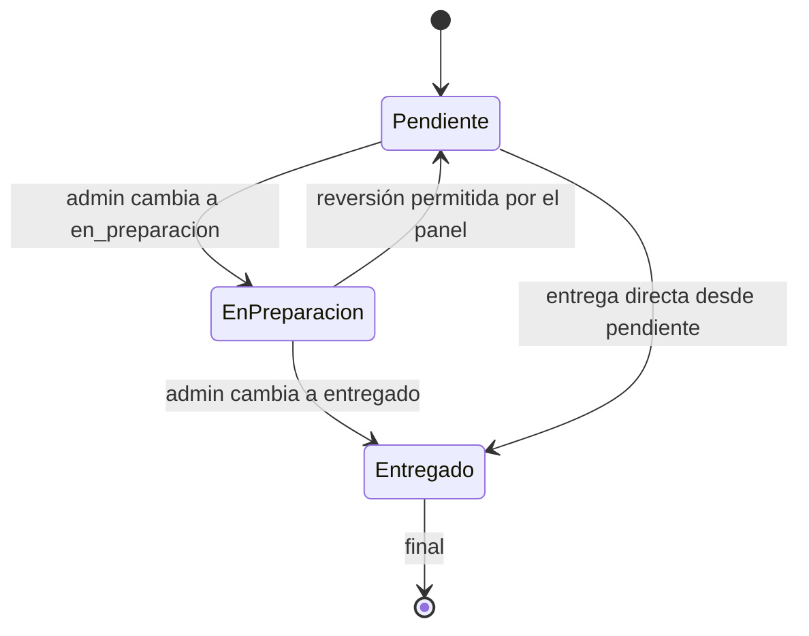

# 05 — Administración (Módulo 4)

Este documento describe el panel de administración del sistema de ventas. Cubre **RF-05** (CRUD de productos con subida de modelos 3D), **RF-06** (gestión de pedidos y cambio de estado) y **RNF-03** (acceso al panel restringido al rol `admin`).

El panel está accesible bajo el prefijo `/admin`, protegido con los middlewares `auth` y `role:admin` configurados en el Módulo 1. No se modificaron migraciones ni modelos: todos los campos necesarios (`imagen_path`, `modelo_3d_path`, `metodo_pago`, `user_id` nullable) ya existían del Módulo 1 al 3.

## Alcance y requerimientos

| Requerimiento | Implementación actual |
| --- | --- |
| RF-05 — CRUD de productos | `Admin\AdminProductoController` con `index`, `create`, `store`, `edit`, `update`, `destroy`; subida de imagen y modelo `.glb/.gltf` a `storage/app/public/productos/` y persistencia de la ruta relativa en `imagen_path` y `modelo_3d_path`. |
| RF-06 — Gestión de pedidos | `Admin\AdminPedidoController` con `index` y `updateEstado`; transición de estados entre `pendiente`, `en_preparacion` y `entregado`. |
| RNF-03 — acceso restringido | Grupo `/admin` con `['auth','role:admin']`; invitado redirige a login, cliente recibe 403, administrador accede. |

## Seguridad y rutas

Todas las rutas de administración viven dentro de:

```php
Route::middleware(['auth', 'role:admin'])
    ->prefix('admin')
    ->name('admin.')
    ->group(function () { ... });
```

| Método | URI | Nombre | Controlador | Descripción |
| --- | --- | --- | --- | --- |
| GET | `/admin` | `admin.dashboard` | `AdminDashboardController` | Panel principal con métricas |
| GET | `/admin/productos` | `admin.productos.index` | `Admin\AdminProductoController` | Listado paginado de productos |
| GET | `/admin/productos/create` | `admin.productos.create` | `Admin\AdminProductoController` | Formulario de nuevo producto |
| POST | `/admin/productos` | `admin.productos.store` | `Admin\AdminProductoController` | Crear producto con archivos |
| GET | `/admin/productos/{producto}/edit` | `admin.productos.edit` | `Admin\AdminProductoController` | Formulario de edición |
| PUT/PATCH | `/admin/productos/{producto}` | `admin.productos.update` | `Admin\AdminProductoController` | Actualizar producto y archivos |
| DELETE | `/admin/productos/{producto}` | `admin.productos.destroy` | `Admin\AdminProductoController` | Eliminar producto y sus archivos |
| GET | `/admin/pedidos` | `admin.pedidos.index` | `Admin\AdminPedidoController` | Listado de pedidos con filtro de estado |
| PATCH | `/admin/pedidos/{pedido}/estado` | `admin.pedidos.updateEstado` | `Admin\AdminPedidoController` | Cambiar estado de un pedido |

Las vistas públicas (`/`, `/productos/{producto}`, `/carrito`, `/pedido/confirmar`) no usan `auth` ni `role:admin` y no se alteraron.

### Comportamiento por sesión

- **Invitado**: al entrar a cualquier ruta `/admin`, recibe redirección (302) a `/login`.
- **Cliente autenticado**: recibe `403` al acceder a `/admin` o a cualquiera de sus subrutas.
- **Administrador autenticado**: recibe `200` y opera el panel con normalidad.

La autorización efectiva está en el middleware `role:admin` (definido en `app/Http/Middleware/EnsureUserHasRole.php` y registrado como alias `role` en `bootstrap/app.php`). El enlace "Panel de Admin" del navbar público solo se renderiza con `@if (auth()->user()?->isAdmin())`, pero es solo un acceso rápido; la autorización real está en el middleware.

## CRUD de productos (RF-05)

### Validación

Se usan dos Form Requests: `App\Http\Requests\StoreProductoRequest` y `App\Http\Requests\UpdateProductoRequest`.

| Campo | Reglas |
| --- | --- |
| `nombre` | `required|string|max:255` |
| `descripcion` | `nullable|string` |
| `precio` | `required|numeric|min:0` |
| `stock` | `required|integer|min:0` |
| `categoria` | `nullable|string|max:255` |
| `activo` | `sometimes|boolean` (normalizado desde el checkbox) |
| `imagen` | `nullable|image|mimes:jpg,jpeg,png,webp|max:4096` |
| `modelo_3d` | `nullable|file|extensions:glb,gltf|max:20480` |

Decisión de validación: el modelo 3D valida con `extensions:glb,gltf` porque los navegadores suelen enviar `.glb` como `application/octet-stream`; validar solo por MIME rechazaría archivos válidos. La imagen sí valida contenido real con `image|mimes`. Los límites son 4 MB para imagen y 20 MB para modelo 3D.

> Nota de entorno: el `php.ini` de desarrollo tiene `upload_max_filesize=24M` y `post_max_size=32M`. En producción deben ajustarse para permitir archivos de hasta 20 MB.

### Almacenamiento

Los archivos se guardan con el disco `public` de Laravel:

```php
Storage::disk('public')->putFile('productos', $archivo);
```

- Nombre único generado automáticamente por Laravel (`putFile`).
- En BD se persiste la **ruta relativa**, por ejemplo `productos/a1b2c3.glb`, en `modelo_3d_path` (y `imagen_path` para la imagen).
- El archivo físico queda en `storage/app/public/productos/` y se sirve mediante el symlink existente `public/storage → storage/app/public`, que permite al visor público cargar `asset('storage/productos/a1b2c3.glb')`.

### Flujo de subida (diagrama Mermaid)

```mermaid
flowchart TD
    A[Admin abre /admin/productos/create] --> B[Formulario multipart con imagen y modelo_3d]
    B --> C[POST /admin/productos + StoreProductoRequest]
    C --> D{"¿Validación OK?"}
    D -->|No| E[Redirige con errores inline, conserva entrada]
    D -->|Sí| F[Guardar imagen con Storage::disk('public')->putFile]
    F --> G[Guardar modelo 3D con putFile]
    G --> H[Persistir rutas relativas en imagen_path y modelo_3d_path]
    H --> I[Flash éxito y redirige a index]
    E --> B
```

### Edición y reemplazo de archivos

En `update()`:

- Si llega un archivo nuevo de imagen/modelo, se guarda el nuevo, se persiste la nueva ruta y se **elimina el archivo anterior** del disco `public` solo si empieza por `productos/` y no contiene `..` (guardas contra traversal).
- Si llega el checkbox `quitar_imagen` o `quitar_modelo`, se anula la ruta en BD y se elimina el archivo físico.
- Si no llega ningún archivo nuevo y no se marca para quitar, se conserva el valor actual de BD.
- Los archivos órfanos se limpian en `destroy()`.

### Eliminación de producto

- Se eliminan primero los archivos asociados (`imagen_path` y `modelo_3d_path`) del disco `public`.
- Se intenta eliminar el registro del producto.
- Si existen filas en `detalle_pedido` que lo referencian, la FK `restrictOnDelete` impide el borrado; se captura `QueryException` y se redirige con: *"No se puede eliminar: tiene pedidos asociados."* (sin 500, sin borrar el producto ni sus archivos).

### Listado

`index()` está paginado, con buscador por nombre/categoría y filtro activo/inactivo. La tabla muestra miniatura (imagen o placeholder), nombre, categoría, precio, stock, activo, indicador de modelo 3D (sí/no) y acciones editar/eliminar (esta última con confirmación).

## Gestión de pedidos (RF-06)

### Listado

`index()` devuelve los pedidos más recientes primero, paginados, con filtro por estado. Usa *eager loading* `user` y `detallesPedido.producto` para evitar N+1. Cada fila muestra:

- Número de pedido y fecha.
- Cliente: nombre del usuario o **"Invitado"** cuando `user_id = NULL`.
- Total y método de pago legible (Efectivo / Tarjeta / Transferencia).
- Estado como badge con color y control de cambio de estado.

### Cambio de estado

`updateEstado(PATCH /admin/pedidos/{pedido}/estado)` valida:

```php
$estado in:pendiente,en_preparacion,entregado
```

Solo actualiza el campo `estado` (ningún otro campo es mas-assignable). Los estados `listo` y `cancelado` existen en el enum de base de datos pero **no son seleccionables** desde el panel según el requerimiento RF-06; si existen en registros antiguos, se muestran en su badge correspondiente.

Cada fila tiene una fila expandible (Alpine, accesible con `aria-expanded` y `aria-controls`) que lista las líneas del pedido: producto, cantidad, precio unitario y subtotal.

### Diagrama de transiciones de estado



Los estados `listo` y `cancelado` se muestran en el detalle pero no son seleccionables desde este módulo.

## Layout y vistas de administración

### Layout `admin.blade.php`

`resources/views/layouts/admin.blade.php` es un layout separado del público (`layouts/app.blade.php`). Características:

- Sidebar lateral con paleta piedra/ámbar (`stone-900` / `stone-800` para el sidebar, `bg-stone-50` para el contenido).
- Marca "Cafetería · Admin", navegación: **Dashboard**, **Productos**, **Pedidos**.
- Enlace "Ver tienda" hacia el catálogo público `/`.
- Barra superior con nombre del usuario autenticado y botón de cierre de sesión.
- Responsive con menú toggle móvil mediante Alpine.js (ya disponible del proyecto).
- Contenido principal con tipografía Instrument Sans y títulos claros.

### Vistas creadas

| Vista | Responsabilidad |
| --- | --- |
| `admin/dashboard.blade.php` | Panel con métricas reales: productos activos, pedidos pendientes, pedidos del día y ventas del día (suma de `total` de pedidos no cancelados); accesos rápidos a "Nuevo producto" y "Ver pedidos". |
| `admin/productos/index.blade.php` | Tabla paginada con buscador y filtro activo/inactivo. |
| `admin/productos/create.blade.php` | Formulario de nuevo producto. |
| `admin/productos/edit.blade.php` | Formulario de edición con valores actuales y previsualización de imagen/modelo existente. |
| `admin/productos/_form.blade.php` | Formulario compartido `multipart/form-data` con `accept="image/*"` para imagen y `accept=".glb,.gltf"` para modelo 3D, errores de validación inline y controles accesibles. |
| `admin/pedidos/index.blade.php` | Listado de pedidos con filtro por estado, badges de estado y filas expandibles con detalle de líneas. |
| `components/estado-pedido.blade.php` | Componente de badge de estado reutilizable. |

El dashboard y el listado de pedidos evitan consultas N+1 mediante eager loading y agregaciones eficientes.

## Cambios en el navbar público

Se añadió el enlace **"Panel de Admin"** visible solo cuando `auth()->user()?->isAdmin()` es verdadero, tanto en la navegación de escritorio como en el menú móvil. Apunta a `admin.dashboard`. Es cosmético; la autorización real está en el middleware.

## Pruebas

Suite ejecutada tras el Módulo 4:

| Comando | Resultado |
| --- | --- |
| `php artisan test --compact` | **71 tests, 325 aserciones, todos pasando** |
| `vendor/bin/pint --format agent` | `passed` |
| `npm run build` | Correcto (aviso preexistente de chunk >500 kB por Three.js) |

Se añadieron:

- `tests/Feature/Admin/AdminProductoTest.php` (14 pruebas): invitado redirige, cliente 403, admin 200, create con `UploadedFile::fake()` de imagen y glb, `Storage::fake('public')` verifica archivo guardado y rutas en BD, update reemplaza y borra el anterior, destroy borra producto y archivos, destroy con pedido asociado no rompe (redirect con error), validación de extensión/tamaño.
- `tests/Feature/Admin/AdminPedidoTest.php` (7 pruebas): acceso por rol, listado con filtro, updateEstado válido e inválido, badge/estado visible.
- `tests/Feature/Admin/AdminDashboardTest.php` (5 pruebas): acceso por rol y métricas.

Las 48 pruebas previas de los módulos 1-3 siguen pasando.

## Guía de prueba manual: subir un modelo 3D real desde la interfaz

1. **Elevar límites de PHP** (el CLI por defecto tiene `upload_max_filesize=24M` y `post_max_size=32M` tras el ajuste del entorno; si los ves más bajos, relánzalos con `-d upload_max_filesize=24M -d post_max_size=32M`):

   ```bash
   cd /opt/proyecto_cafeteria
   php artisan serve
   ```

2. **Entrar como administrador**:

   | Email | Contraseña |
   | --- | --- |
   | `admin@cafeteria.test` | `password` |

   (Estas credenciales se crean con el seeder `php artisan db:seed`.)

3. Ir a **Panel de Admin → Productos → Nuevo producto** (`/admin/productos/create`).

4. Completar nombre, precio, stock, categoría, activo, adjuntar una imagen y seleccionar un archivo `.glb` o `.gltf` de hasta 20 MB. Enviar.

5. Debe aparecer el flash de éxito y el indicador **"Modelo 3D: Sí"** en el listado de productos.

6. Verificar el archivo y la ruta en BD:

   ```bash
   ls -l storage/app/public/productos
   php artisan tinker --execute 'echo App\Models\Producto::latest("id")->first()->modelo_3d_path;'
   ```

   Deberías ver algo como `productos/abc123.glb`.

7. Abrir la ficha pública `/productos/{id}`: el visor 3D del Módulo 2 cargará el modelo desde `asset('storage/'.$producto->modelo_3d_path)`.

8. Para probar la edición: entrar al producto creado, subir otro `.glb` en sustitución y comprobar que el anterior desapareció de `storage/app/public/productos` y de `modelo_3d_path`.

### Recomendaciones de exportación del modelo 3D

- Usar **GLB** (un solo archivo) en lugar de glTF + `.bin` + texturas sueltas, para evitar rutas relativas rotas.
- **Sin compresión Draco ni KTX2/meshopt**: el visor registra `GLTFLoader` sin `DRACOLoader` ni transcoder KTX2.
- Menos de 2–3 MB y unas decenas de miles de triángulos para cumplir el objetivo de carga del Módulo 2 (RNF-02).

## Notas importantes

- No se crearon ni modificaron migraciones ni modelos en este módulo; se reutilizaron `productos`, `pedidos`, `detalle_pedido` y sus enums existentes.
- No se implementó inventario ni reportes (Módulo 5).
- El panel es funcional para catálogo y pedidos; los movimientos de inventario esperan el Módulo 5.

