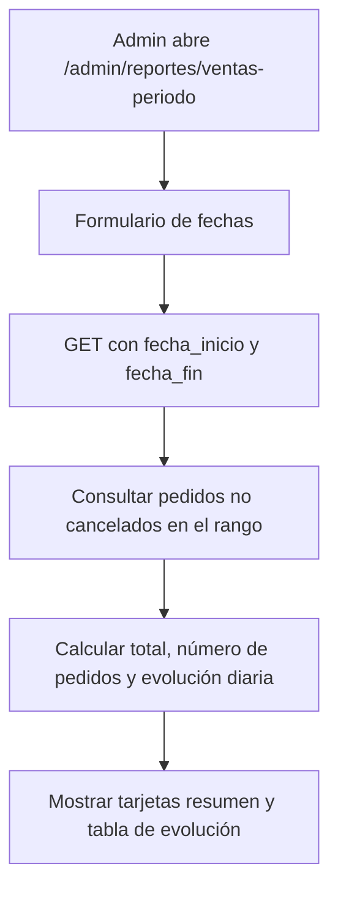

# 06 — Inventario y reportes (Módulo 5)

Este documento describe el módulo de inventario y reportes de ventas. Cubre **RF-07** (inventario de insumos con entradas y salidas) y **RF-08** (reportes de ventas por período y por producto).

El módulo se integra al panel de administración existente (`/admin`, middleware `auth` + `role:admin`) y reutiliza el layout `resources/views/layouts/admin.blade.php` con la paleta piedra/ámbar. No se crearon ni modificaron migraciones ni modelos: se reutilizan `insumos`, `movimientos_inventario`, `pedidos`, `detalle_pedido` y sus enums (`TipoMovimiento`, `EstadoPedido`, `MetodoPago`) creados en módulos previos.

## Alcance y requerimientos

| Requerimiento | Implementación actual |
| --- | --- |
| RF-07 — Inventario de insumos | `Admin\AdminInsumoController` (CRUD) y `Admin\AdminMovimientoController` (registro de entrada/salida/ajuste). El stock del insumo se actualiza automáticamente al registrar un movimiento, dentro de una transacción de base de datos. |
| RF-08 — Reportes de ventas | `Admin\AdminReporteController` con `ventasPorPeriodo` (rango de fechas, total, número de pedidos, evolución diaria) y `ventasPorProducto` (ranking de más vendidos: cantidad y total recaudado). |

## Seguridad y rutas

Todas las rutas viven dentro del grupo protegido:

```php
Route::middleware(['auth', 'role:admin'])
    ->prefix('admin')
    ->name('admin.')
    ->group(function () { ... });
```

| Método | URI | Nombre | Controlador | Descripción |
| --- | --- | --- | --- | --- |
| GET | `/admin/insumos` | `admin.insumos.index` | `Admin\AdminInsumoController` | Listado paginado con buscador y filtro bajo stock |
| GET | `/admin/insumos/create` | `admin.insumos.create` | `Admin\AdminInsumoController` | Formulario de nuevo insumo |
| POST | `/admin/insumos` | `admin.insumos.store` | `Admin\AdminInsumoController` | Crear insumo |
| GET | `/admin/insumos/{insumo}/edit` | `admin.insumos.edit` | `Admin\AdminInsumoController` | Formulario de edición |
| PUT/PATCH | `/admin/insumos/{insumo}` | `admin.insumos.update` | `Admin\AdminInsumoController` | Actualizar insumo |
| DELETE | `/admin/insumos/{insumo}` | `admin.insumos.destroy` | `Admin\AdminInsumoController` | Eliminar (bloqueado si tiene movimientos) |
| GET | `/admin/insumos/{insumo}/movimientos/create` | `admin.insumos.movimientos.create` | `Admin\AdminMovimientoController` | Formulario de nuevo movimiento |
| POST | `/admin/insumos/{insumo}/movimientos` | `admin.insumos.movimientos.store` | `Admin\AdminMovimientoController` | Registrar movimiento y actualizar stock |
| GET | `/admin/reportes/ventas-periodo` | `admin.reportes.ventasPeriodo` | `Admin\AdminReporteController` | Reporte de ventas por rango de fechas |
| GET | `/admin/reportes/ventas-producto` | `admin.reportes.ventasProducto` | `Admin\AdminReporteController` | Ranking de productos más vendidos |

### Comportamiento por sesión
- **Invitado**: redirección (302) a `/login` en cualquier ruta `/admin`.
- **Cliente autenticado**: `403` al acceder a cualquier ruta del panel.
- **Administrador autenticado**: acceso completo.

## Inventario (RF-07)

### CRUD de insumos

`AdminInsumoController` implementa `index`, `create`, `store`, `edit`, `update`, `destroy`.

**Validación** (`StoreInsumoRequest` / `UpdateInsumoRequest`):

| Campo | Reglas |
| --- | --- |
| `nombre` | `required|string|max:255` |
| `unidad_medida` | `required|string|max:50` |
| `stock_actual` | `required|numeric|min:0` |
| `stock_minimo` | `required|numeric|min:0` |
| `costo_unitario` | `nullable|numeric|min:0` |

### Registro de movimientos y actualización automática de stock

`AdminMovimientoController@store` registra un movimiento y actualiza el stock del insumo de forma atómica:

**Validación** (`StoreMovimientoRequest`):

| Campo | Reglas |
| --- | --- |
| `tipo` | `required|string|in:entrada,salida,ajuste` |
| `cantidad` | `required|numeric|min:0.001` |
| `motivo` | `nullable|string|max:255` |

**Lógica transaccional** (`DB::transaction`):

1. Si el tipo es `salida`, se valida que `stock_actual - cantidad >= 0`. Si no, se rechaza con error de validación y **ningún cambio** se persiste (rollback implícito al no entrar a la transacción).
2. Dentro de la transacción:
   - `entrada`: `stock_actual = stock_actual + cantidad`
   - `salida`: `stock_actual = stock_actual - cantidad`
   - `ajuste`: `stock_actual = cantidad` (se establece el stock físico contado)
3. Se crea el registro en `movimientos_inventario` con `insumo_id`, `tipo`, `cantidad`, `motivo` y `user_id` del administrador autenticado.
4. Se actualiza `stock_actual` del insumo.

**Diagrama de flujo del registro de movimiento:**

```mermaid
flowchart TD
    A[Admin abre formulario de movimiento] --> B[POST /admin/insumos/{id}/movimientos]
    B --> C{"¿Validación OK?"}
    C -->|No| D[Redirige con errores al formulario]
    D --> B
    C -->|Sí| E{"¿Tipo salida y stock insuficiente?"}
    E -->|Sí| F[Rechazar: no hay suficiente stock, sin cambios]
    E -->|No| G[DB::transaction]
    G --> H[Crear MovimientoInventario]
    H --> I[Actualizar stock_actual del insumo]
    I --> J[Flash éxito y redirige a listado]
```

### Eliminación protegida

Un insumo que tenga movimientos asociados no se puede eliminar (FK `restrictOnDelete`). Se captura `QueryException` y se redirige con: *"No se puede eliminar: tiene movimientos de inventario asociados."*

## Reportes (RF-08)

### Ventas por período (`ventasPorPeriodo`)

Recibe `fecha_inicio` y `fecha_fin` (query params, opcionales; por defecto los últimos 30 días). Valida que `fecha_fin >= fecha_inicio`.

Consulta pedidos no cancelados (`estado <> 'cancelado'`) con `created_at` entre las fechas, y devuelve:

- **Total vendido**: suma de `total`.
- **Número de pedidos**: conteo de pedidos.
- **Ticket promedio**: total dividido por número de pedidos.
- **Evolución diaria**: agrupación por `DATE(created_at)` con pedidos y total por día, mostrada como tabla con barras de progreso proporcionales.



### Ventas por producto (`ventasPorProducto`)

Ranking de los productos más vendidos. Agrupa `detalle_pedido` por `producto_id`, suma `cantidad` y `subtotal`, hace join con `productos` para obtener el nombre, y ordena por cantidad descendente (top 10). Solo considera pedidos no cancelados.

Muestra tabla con: producto, cantidad vendida, total recaudado y participación porcentual sobre el total general.

## Vistas y layout

Se reutiliza `resources/views/layouts/admin.blade.php` (sidebar con paleta piedra/ámbar, navbar superior, `<x-flash-banner />`).

### Vistas creadas

| Vista | Archivo | Responsabilidad |
| --- | --- | --- |
| Insumos listado | `resources/views/admin/insumos/index.blade.php` | Tabla con stock, badge de bajo stock, buscador, filtro |
| Insumo crear/editar | `create.blade.php`, `edit.blade.php`, `_form.blade.php` | Formulario con validación inline |
| Movimiento crear | `resources/views/admin/insumos/movimientos/create.blade.php` | Formulario tipo entrada/salida/ajuste con cantidad y motivo |
| Reporte por período | `resources/views/admin/reportes/ventas-periodo.blade.php` | Filtro de fechas, tarjetas resumen, tabla evolución |
| Reporte por producto | `resources/views/admin/reportes/ventas-producto.blade.php` | Tabla ranking con barras de participación |

### Sidebar

Se agregaron dos enlaces al sidebar del layout admin:
- **Inventario** → `admin.insumos.index`
- **Reportes** → `admin.reportes.ventasPeriodo`

Están resaltados según la ruta activa y siguen la misma paleta stone/ámbar que los enlaces existentes (Dashboard, Productos, Pedidos).

## Seeder de insumos

Se creó `database/seeders/InsumoSeeder` (idempotente con `updateOrCreate`) y se registró en `DatabaseSeeder`. Crea 3 insumos de prueba:

| Insumo | Unidad | Stock inicial | Stock mínimo | Costo unitario |
| --- | --- | --- | --- | --- |
| Café en grano | kg | 10.000 | 2.000 | S/ 18.50 |
| Leche | lt | 20.000 | 5.000 | S/ 2.80 |
| Vasos | unidad | 100.000 | 20.000 | S/ 0.15 |

Ejecutar con: `php artisan db:seed --force`.

## Pruebas

Suite ejecutada tras el Módulo 5:

| Comando | Resultado |
| --- | --- |
| `php artisan test` | **81 tests, 354 aserciones, todos pasando** |
| `vendor/bin/pint --format agent` | `fixed` (estilo aplicado) |
| `npm run build` | Correcto (aviso preexistente de chunk >500 kB por Three.js) |

Se añadieron:
- `tests/Feature/Admin/AdminInsumoTest.php` (7 pruebas): acceso por rol, listado, creación, validación de stock negativo, actualización, eliminación bloqueada con movimientos.
- `tests/Feature/Admin/AdminMovimientoTest.php` (5 pruebas): entrada aumenta stock, salida disminuye stock, salida excedente rechaza sin cambios, ajuste establece stock, invitado redirige.
- `tests/Feature/Admin/AdminReporteTest.php` (6 pruebas): acceso por rol, filtro de fechas, ranking de productos, invitado/cliente rechazados.

Los 71 tests previos (módulos 1-4) siguen pasando.

## Cómo probar desde la interfaz

1. Levantar el servidor (con límites de PHP para subidas, aunque el inventario no sube archivos):
   ```bash
   cd /opt/proyecto_cafeteria
   php artisan serve
   ```

2. Entrar como administrador:
   | Email | Contraseña |
   | --- | --- |
   | `admin@cafeteria.test` | `password` |

3. Ir a **Panel de Admin → Inventario**. Verá los 3 insumos del seeder (Café en grano, Leche, Vasos) con su stock y badge de bajo stock si aplica.

4. Para registrar un movimiento: hacer clic en "Movimiento" de un insumo, elegir tipo (Entrada/Salida/Ajuste), cantidad y motivo. Al guardar, el stock del insumo se actualiza automáticamente y se muestra un flash de éxito.

5. Probar una salida que exceda el stock: debe rechazarse con un error y el stock no debe cambiar.

6. Ir a **Panel de Admin → Reportes → Ventas por período** o **Ventas por producto** para ver los reportes. Si no hay pedidos, se muestra un estado vacío elegante.

## Notas importantes

- No se crearon ni modificaron migraciones ni modelos en este módulo. Se reutilizó el esquema existente.
- El stock se actualiza dentro de `DB::transaction` para evitar inconsistencias.
- Las salidas se validan contra el stock disponible antes de la transacción, evitando sobreventa.
- Los estados de pedido `listo` y `cancelado` se excluyen de los reportes de ventas (solo se consideran no cancelados).
- No se implementaron movimientos de inventario vinculados a pedidos de venta automáticamente; el registro de movimientos es una acción administrativa manual.

